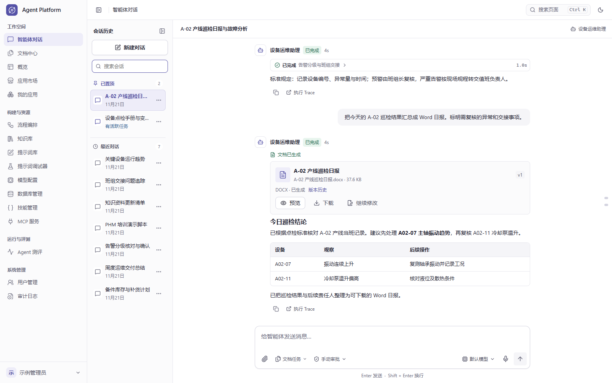
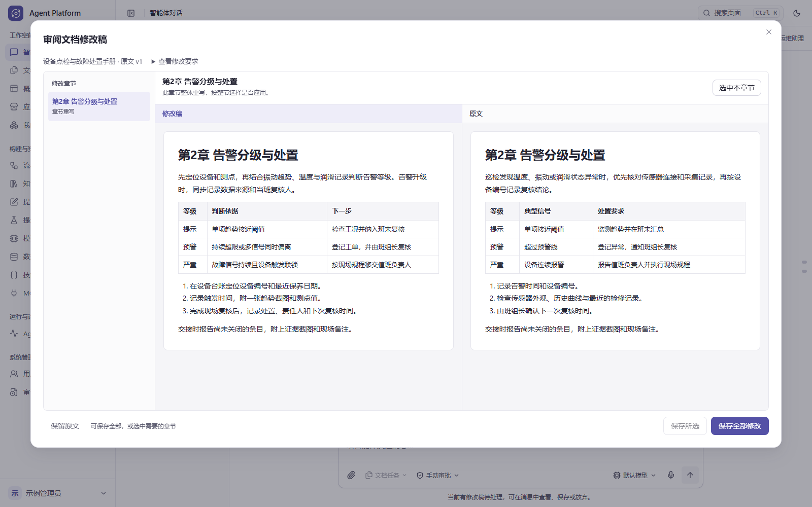
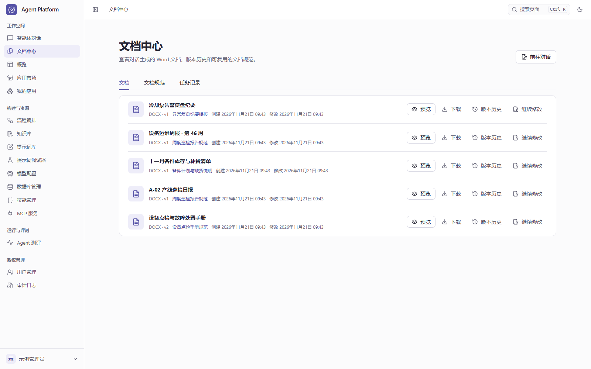
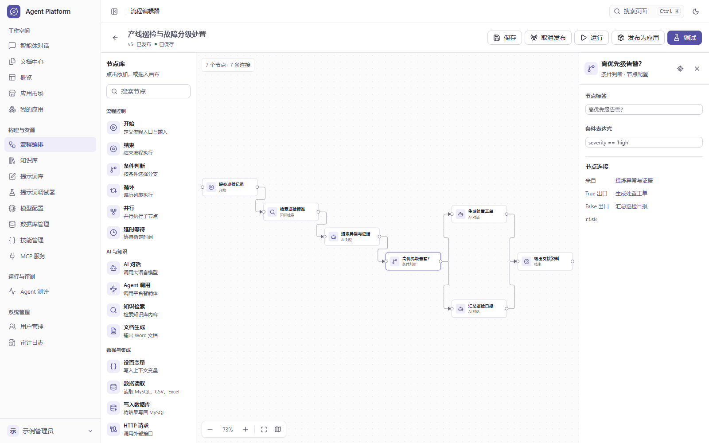
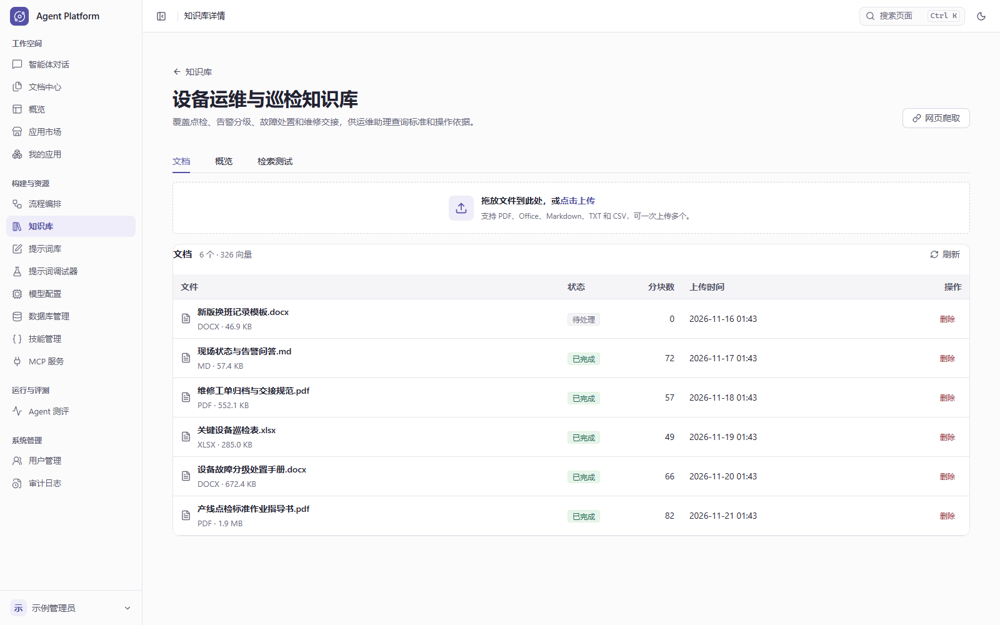
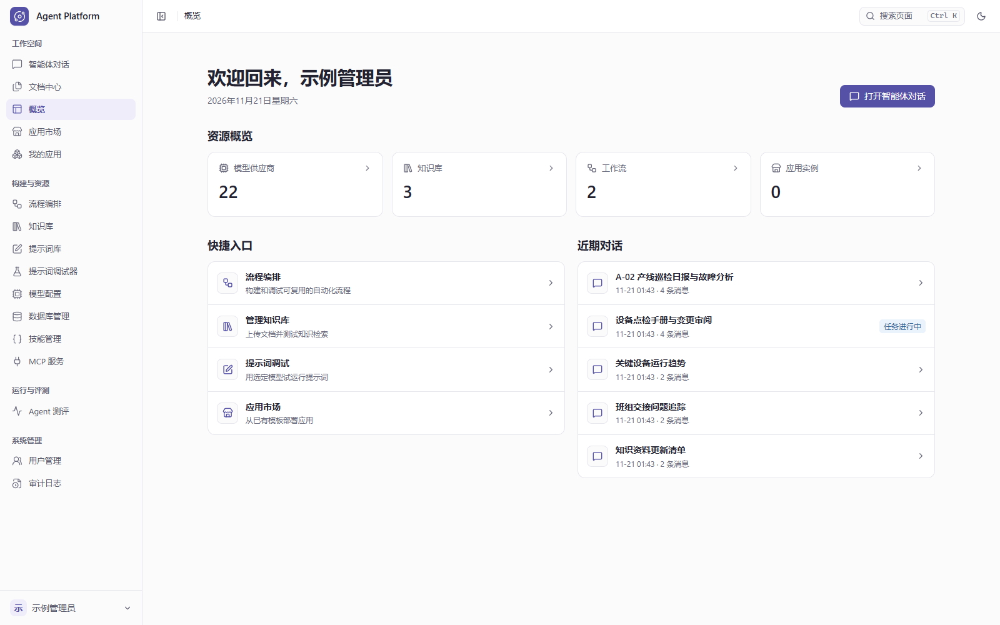
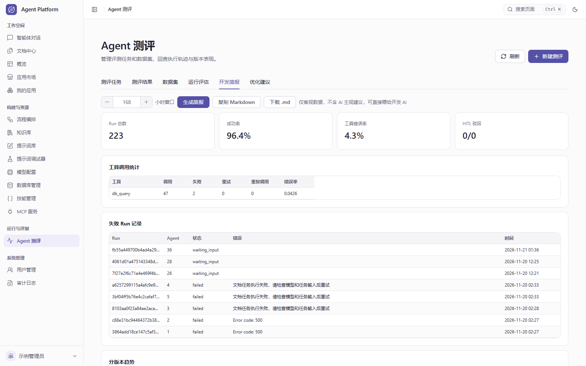
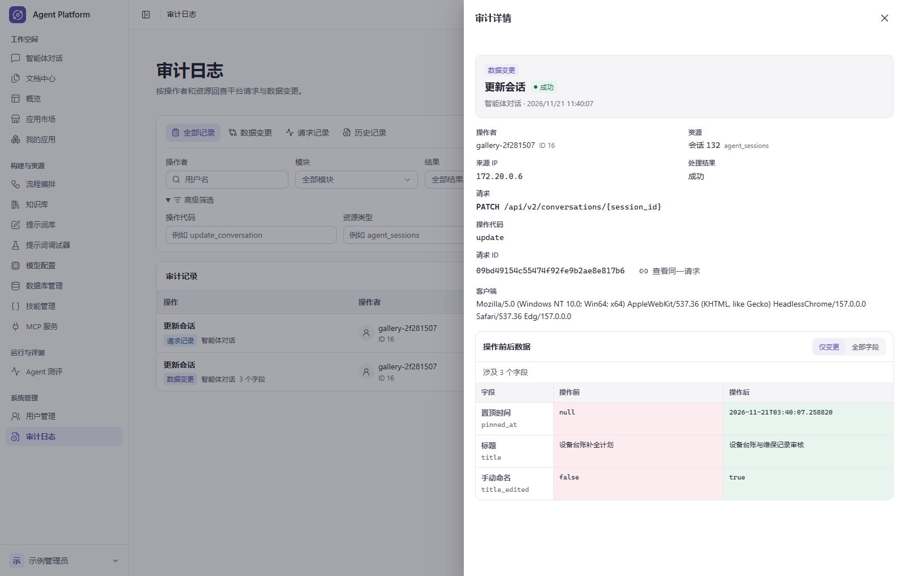
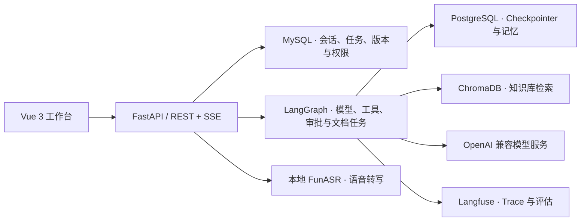

# General Agent Platform

General Agent Platform 是可私有化部署的智能体工作台。团队可以在同一界面管理对话和附件、生成和审阅 Word 文档、用知识库检索企业资料，以及在画布上编排业务流程。任务运行支持流式事件、人工审批与断点续跑，管理员可以通过执行轨迹、测评和开发简报查看运行情况。

[界面预览](#界面预览) · [功能与使用入口](#功能与使用入口) · [Docker 部署](#docker-部署) · [本地开发](#本地开发) · [技术架构](#技术架构) · [MIT License](LICENSE)

## 界面预览

以下截图取自当前版本的演示环境，使用模拟业务数据。

### 智能体对话

左侧的「已置顶」与「最近对话」分区展示。可在会话菜单中置顶、取消置顶和重命名。主区支持流式回答、文件粘贴、本地语音听写、工具执行卡和侧栏文件预览。



### 文档修改审阅

同一章节的修改稿在左，原文在右。结合实际正文、表格和图片检查建议，按章节或可独立应用的改动保存新版本。



### 文档资产、工作流和知识库

| 文档中心 · 管理文档、规范与版本 | 流程编排 · 连接任务节点并配置运行参数 |
| --- | --- |
| [](docs/screenshots/current/03-document-center.png) | [](docs/screenshots/current/04-workflow.png) |
| **知识库 · 管理资料、索引与检索** | **概览 · 查看已部署资源和常用入口** |
| [](docs/screenshots/current/05-knowledge.png) | [](docs/screenshots/current/06-dashboard.png) |

### 运行与测评

从同一管理界面维护评测数据集、查看运行结果和定位执行问题。开发简报汇总执行、工具与审批等客观指标，并支持导出 Markdown。



### 操作审计

系统管理员可以在「审计日志」筛选操作者、资源、时间和处理结果。数据变更详情支持逐字段对照，并可沿请求 ID 找到同一请求的处理结果。



## 功能与使用入口

| 入口 | 能做什么 |
| --- | --- |
| **智能体对话** | 管理历史会话，上传或粘贴附件，切换模型和审批模式。图片、Word 和 PDF 可在可拖宽的侧栏查看。配置本地转写服务后，录音可转换成可编辑的消息文本。 |
| **文档中心** | 从资料提取可复用规范，按规范生成 DOCX，或者把已有对话文稿导出为 Word。支持章节进度、文档续跑、修改审阅、版本历史和文件下载。原始 DOCX 可按版式预览，也支持针对原文段落和图片提出修改。 |
| **知识库与模型配置** | 接入 OpenAI 兼容的模型服务，在知识库中上传和索引资料，通过检索页面验证召回，并将知识库用于智能体和工作流。 |
| **流程编排与应用市场** | 在画布上连接条件、AI 对话、知识检索、HTTP 请求、数据处理和文档输出等节点。通过提示词库管理模板和在线调试，或从应用市场部署已有模板。 |
| **Agent 测评** | 管理数据集、触发测试运行和查看逐项得分。支持 Langfuse Trace 跳转、评估回写、建议应用与回滚。开发简报提供可筛选的运行数据。 |
| **系统管理** | 管理员可管理用户、角色、技能、MCP 工具服务和数据库连接。审计日志记录业务请求及处理结果，可按操作者、资源和请求 ID 查询已落库的字段变更，对照操作前后的数据。 |

## Docker 部署

需要 Docker Engine 或 Docker Desktop，以及 Docker Compose v2。以下命令在仓库根目录执行。

1. 首次安装时复制部署配置，再填写密码和密钥。

   ```bash
   cp docker/.env.example docker/.env
   openssl rand -hex 32
   ```

   将随机值填入 `SECRET_KEY`，并设置 `MYSQL_ROOT_PASSWORD`、`MYSQL_PASSWORD`、`POSTGRES_PASSWORD` 和至少 12 位的强密码 `ADMIN_PASSWORD`。数据库密码可使用独立生成的随机十六进制字符串，便于直接插入连接串。Windows PowerShell 可用 `Copy-Item docker/.env.example docker/.env` 复制。管理员首次登录使用 `ADMIN_USERNAME`（默认 `admin`）与配置中的密码。

2. 准备 Compose 引用的外部 Docker 网络。

   已部署 Langfuse 时沿用其 `langfuse-deploy_default` 网络。独立部署平台时先用 `docker network inspect langfuse-deploy_default` 检查，网络缺失时执行以下命令。

   ```bash
   docker network create langfuse-deploy_default
   ```

3. 构建镜像并启动服务。

   ```bash
   docker compose --env-file docker/.env -f docker/docker-compose.yml up -d --build
   docker compose --env-file docker/.env -f docker/docker-compose.yml ps
   ```

   后端入口先执行 Alembic 迁移，再启动服务。首次启动 ASR 时会下载 CPU 语音模型，包括 SenseVoice 和 VAD。需要检查迁移或语音服务时，可在下列命令中分别指定 `backend` 或 `asr`。

   ```bash
   docker compose --env-file docker/.env -f docker/docker-compose.yml logs -f backend
   ```

| 服务 | 地址与用途 |
| --- | --- |
| 平台 | [http://localhost](http://localhost) |
| 后端 | [健康检查](http://localhost:8000/api/health) · [OpenAPI 文档](http://localhost:8000/api/docs) · [Prometheus 指标](http://localhost:8000/metrics) |
| MySQL / Redis / PostgreSQL | 宿主机回环地址 `127.0.0.1`，分别使用 `3308`、`6379` 与 `5433` |
| ASR | Docker 项目网络中的 `http://asr:8000`，由平台后端转发 |

登录后在「模型配置」登记模型服务、访问密钥和模型名称，再到「智能体对话」选择可用模型。启用 Langfuse 时，在 `docker/.env` 配置 `LANGFUSE_PUBLIC_KEY`、`LANGFUSE_SECRET_KEY` 和可访问的服务地址，浏览器跳转地址由 `LANGFUSE_PUBLIC_URL` 控制。语音服务的检查与停用见 [本地语音转写服务](deploy/asr/README.md)。

## 本地开发

后端使用 Python 3.11，推荐在虚拟环境内安装依赖。前端开发和测试使用 Node.js 22。可沿用 Docker Compose 的 MySQL、Redis、PostgreSQL 服务，并让前后端进程在宿主机运行。

```bash
docker compose --env-file docker/.env -f docker/docker-compose.yml up -d mysql redis checkpoint_pg
```

### 后端

从仓库根目录进入 `backend/`。首次配置时将 `.env.example` 复制为 `.env`，按照数据库实际端口和账户填写 `DATABASE_URL` 与 `DATABASE_SYNC_URL`，并设置本地管理员凭据。使用 Compose 的 MySQL 时连接 `127.0.0.1:3308`。单进程开发可沿用模板中的 SQLite Checkpointer，跨进程恢复使用共享 PostgreSQL 的 `AGENT_CHECKPOINT_DSN`。配置完成后执行以下命令。

```bash
cd backend
python -m pip install -r requirements.txt
python -m alembic upgrade head
python -m uvicorn app.main:app --host 127.0.0.1 --port 8002 --reload
```

宿主机开发需要安装 LibreOffice 才能验证 Word 版式预览。启用语音输入时安装 FFmpeg，并给 `ASR_BASE_URL` 配置后端可访问的转写地址。Docker 后端镜像已包含 LibreOffice Writer 和 FFmpeg。

### 前端与测试

另开一个终端，从仓库根目录进入 `frontend/`。

```bash
cd frontend
npm ci
npm run dev
```

开发入口默认是 [http://localhost:5173](http://localhost:5173)，Vite 将 `/api` 代理到 `127.0.0.1:8002`。

| 检查 | 运行目录与命令 |
| --- | --- |
| 后端全量测试 | `backend/` 内运行 `python -m pytest -q` |
| 前端交互测试 | `frontend/` 内运行 `npm test` |
| 前端类型检查和生产构建 | `frontend/` 内运行 `npm run build` |

## 技术架构



Vue 3、TypeScript、Vite 与 Element Plus 提供工作台。FastAPI 和异步 SQLAlchemy 管理 API 与数据。模型执行事件写入 MySQL，通过 SSE 回放给浏览器。LangGraph 使用 PostgreSQL 持久化状态，配合执行租约恢复中断的任务。文档链路管理 Word 草稿、审阅决定和交付版本。平台运行指标通过 Prometheus 暴露，Grafana 仪表盘定义位于 [docker/grafana/](docker/grafana/)。

| 路径 | 内容 |
| --- | --- |
| [backend/app/api/](backend/app/api/) | v1 业务接口与 v2 工作台 API |
| [backend/app/services/agent_runtime/](backend/app/services/agent_runtime/) | 智能体任务、Worker、流式事件和检查点 |
| [backend/app/services/documents/](backend/app/services/documents/) | 文档规范、生成、编辑、审阅和预览 |
| [frontend/src/](frontend/src/) | 工作台页面、文档组件、API 与导航 |
| [docker/](docker/) · [deploy/asr/](deploy/asr/) | Compose 部署、镜像、监控和语音服务 |

## 项目资料与许可

- [开发协作指南](AGENTS.md)
- [历史设计、任务书与交付文档](docs/historyFile/)
- [MIT License](LICENSE)
