# General Agent Platform

企业级 AI 通用能力大平台与业务落地平台（v2.0）—— 可私有化部署的通用 Agent 平台：多模型对话、Agent 智能体、企业知识库（RAG）、可视化流程编排、提示词工程、应用市场，以及 **Langfuse 全链路可观测** 与 **Agent 自进化闭环**。

| | |
|---|---|
| 后端 | FastAPI + SQLAlchemy (async) + Alembic + MySQL + Redis + ChromaDB |
| Agent 引擎 | LangChain / LangGraph 执行内核 + Durable Execution（PostgreSQL Checkpointer 断点续跑） |
| 推理层 | OpenAI 兼容 API + 连接池 + 并发队列 + 30B 模型优化 |
| 前端 | Vue 3 + Element Plus + Vite + TypeScript + Pinia |
| 可观测 | Langfuse（Trace / 评估回写）+ OpenTelemetry + Prometheus / Grafana |
| 部署 | Docker Compose |

---

## 界面预览

### 登录与工作台

| 登录 | 概览工作台 |
|---|---|
| 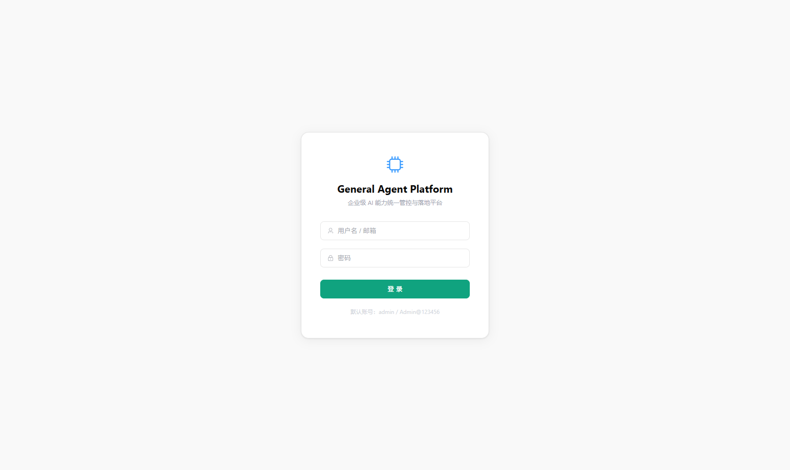 | 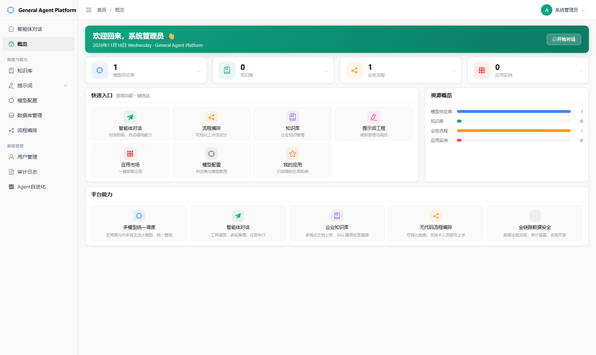 |

### 核心能力

**智能体对话** — 流式对话、工具调用、多模型切换、人机协同审批：

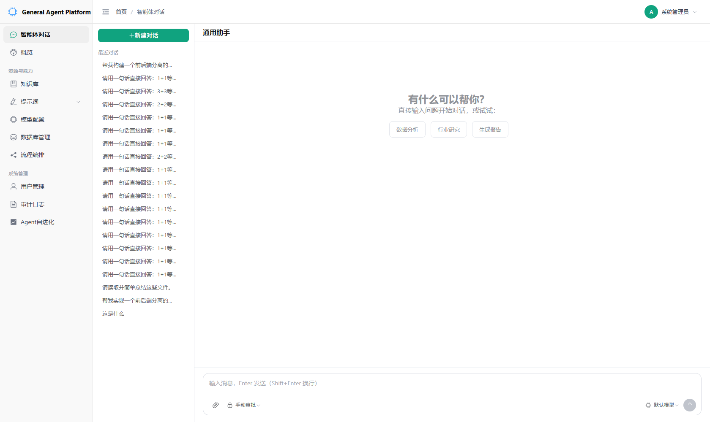

**模型配置** — 多供应商接入（OpenAI 兼容）、连接测试、统一管控：

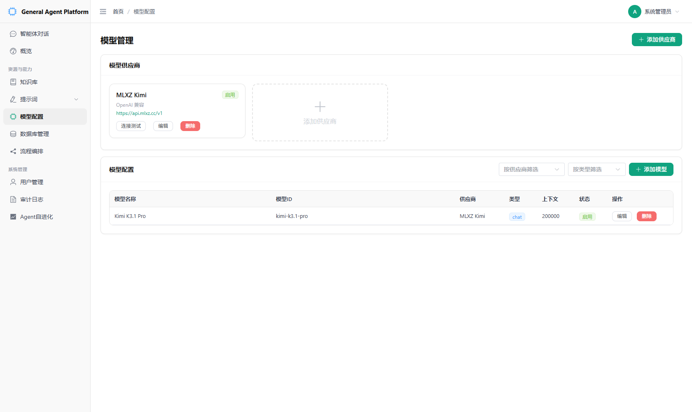

**企业知识库** — 文档上传（PDF / Word / Excel / PPT / TXT）、向量化、RAG 语义检索：

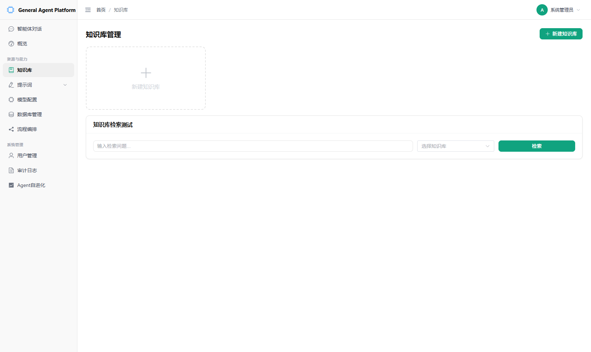

**可视化流程编排** — 拖拽节点设计自动化工作流（AI / 条件 / HTTP / 知识检索节点）：

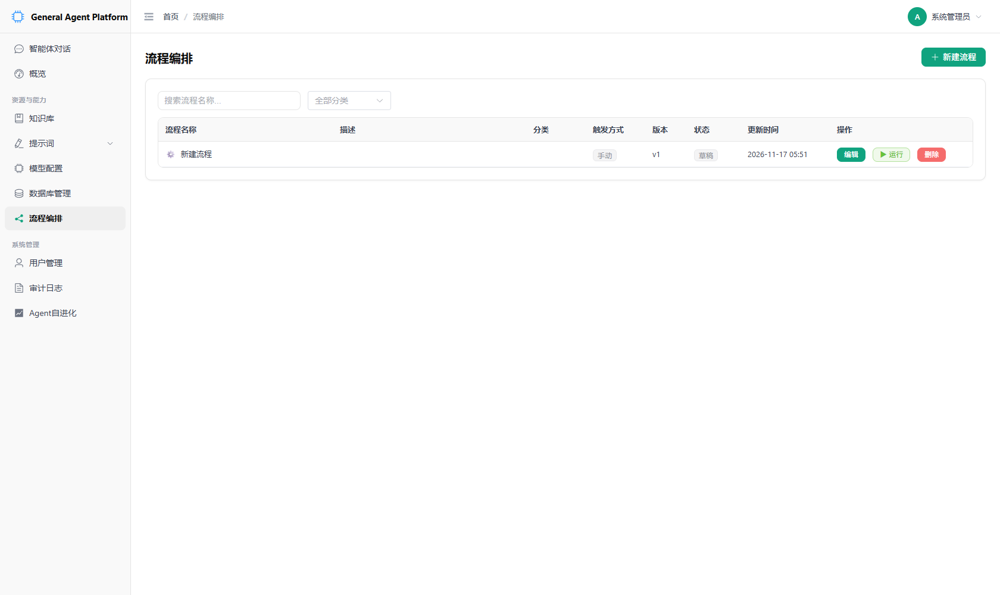

**提示词工程** — 模板管理 + 在线调试，沉淀团队最佳实践：

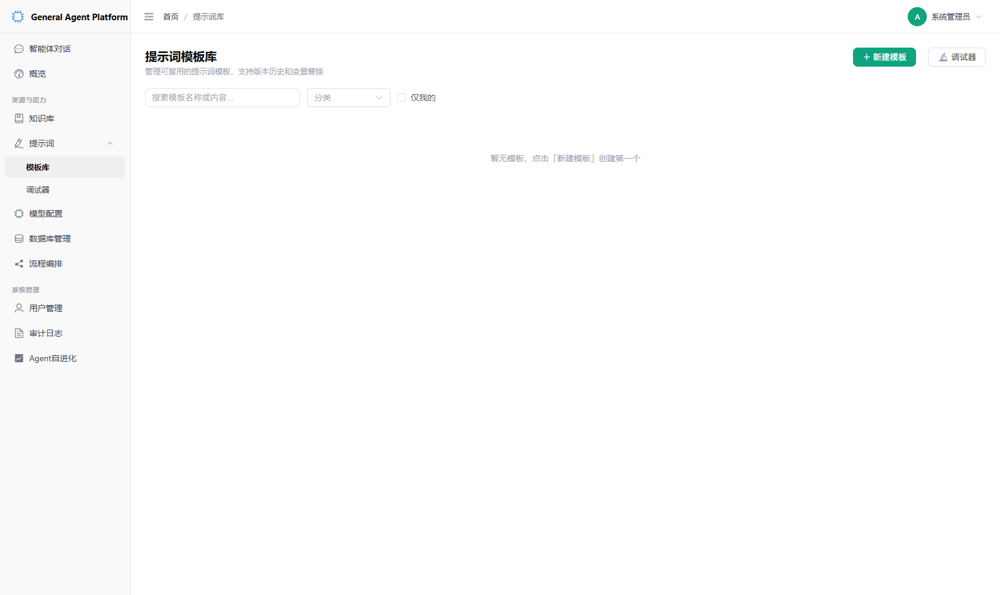

### Agent 自进化闭环

基于执行过程客观数据的迭代支撑体系：确定性指标（工具错误率 / 重试 / 重复调用 / HITL 驳回 / 预算消耗）、LLM 六维裁判评估、进化报告与配置变更回滚、**开发迭代简报**（纯客观数据，可直接喂给开发 AI）。

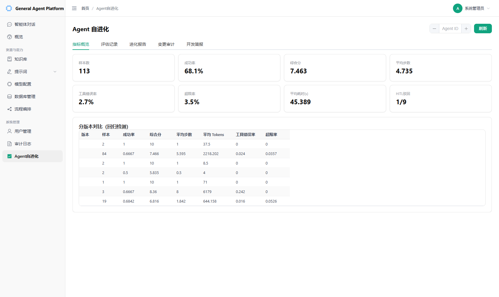

开发简报——按窗口汇总执行概览 / 失败 Run / 工具统计 / HITL 数据 / 分版本趋势 / 评估数据 / 变更审计，一键导出 Markdown：

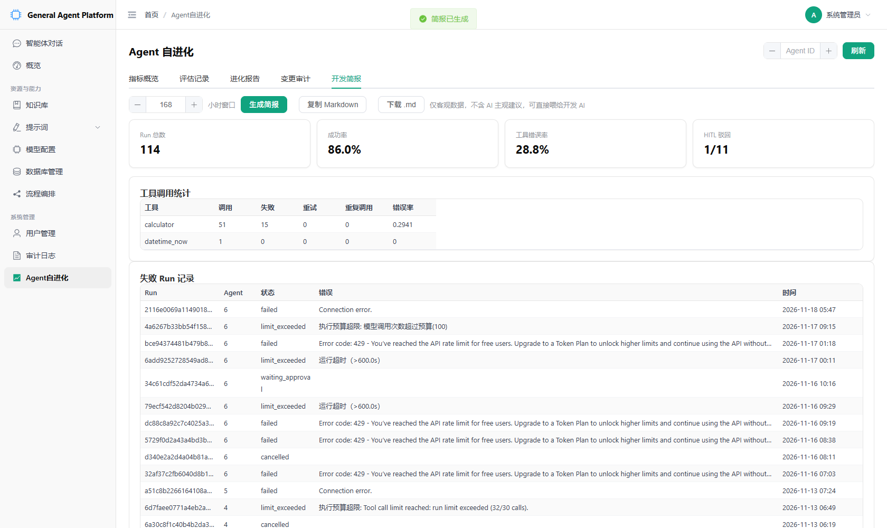

### Langfuse 全链路可观测

每次 Agent 运行上报确定性 trace_id 的完整 Trace（模型调用、工具执行、中间件 span、token / 耗时），平台内一键跳转：

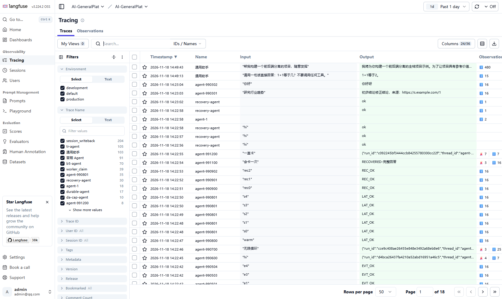

Trace 详情内的完整执行过程 span 树（模型输入输出、工具调用、耗时与 token 开销）：

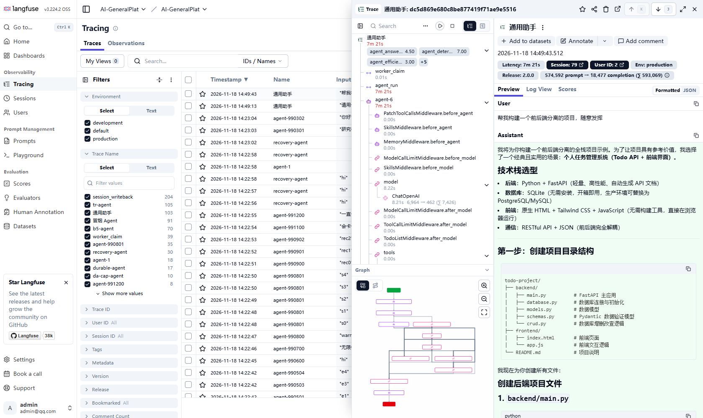

---

## 功能模块

| 模块 | 功能 |
|---|---|
| 🔐 认证管理 | JWT 登录、Token 刷新、修改密码、RBAC 权限 |
| 🤖 模型管理 | 多供应商接入（OpenAI 兼容）、模型配置、连接测试 |
| 💬 AI 对话 | 流式对话、知识库 RAG 增强、多模型切换 |
| 📚 知识库 | 文档上传（PDF/Word/Excel/PPT/TXT）、向量化、语义检索 |
| ⚙️ 流程编排 | 可视化画布、多节点类型（AI/条件/HTTP/知识检索）、流程执行 |
| 🏪 应用市场 | 内置 10+ 行业应用模板、一键部署、应用实例管理 |
| 👥 用户管理 | 用户 CRUD、角色分配、启用/禁用 |
| 📋 审计日志 | 操作记录、多维度过滤、详情查看 |
| 🧠 Agent 智能体 | 增强 ReAct 引擎、结构化记忆、幻觉抑制、执行轨迹追踪、断点续跑 |
| 📊 性能监控 | 推理延迟、工具成功率、token 吞吐、慢请求告警、Prometheus 指标 |
| 🔍 可观测 | Langfuse Trace 上报与 Trace 链接、LLM 裁判评估回写 |
| 🔄 Agent 自进化 | 确定性指标 + 评估聚合 + 进化报告 + 配置变更 / 回滚 + 开发简报 |

---

## 本地开发启动

### 前置条件
- Python 3.11+
- Node.js 20+
- MySQL（本地 3306 或 Docker 3308）
- Redis（可选，降级为内存模式）

### 后端

```bash
cd backend

# 1. 安装依赖
pip install -r requirements.txt -i https://pypi.tuna.tsinghua.edu.cn/simple

# 2. 配置环境变量（复制并修改）
cp .env.example .env
# 修改 DATABASE_URL 中的密码

# 3. 创建数据库
python -c "import pymysql; conn=pymysql.connect(host='localhost',port=3306,user='root',password='YOUR_PWD'); conn.cursor().execute('CREATE DATABASE IF NOT EXISTS ai_plat CHARACTER SET utf8mb4'); conn.commit(); conn.close()"

# 4. 运行数据库迁移
python -m alembic upgrade head

# 5. 启动后端（开发模式）
python -m uvicorn app.main:app --host 0.0.0.0 --port 8002 --reload
```

后端启动后访问：
- API 文档：http://localhost:8002/api/docs
- 健康检查：http://localhost:8002/api/health

### 前端

```bash
cd frontend

# 1. 安装依赖
npm install --registry https://registry.npmmirror.com

# 2. 启动开发服务器
npm run dev
```

前端默认在 http://localhost:5173 启动（端口被占用会自动递增）。

> **注意**：`vite.config.ts` 中的代理目标需与后端端口一致，默认配置为 `http://127.0.0.1:8002`。

### 默认账号
- 用户名：`admin`
- 密码：`Admin@123456`

### 运行测试

```bash
# 后端全量回归（必须在 backend/ 目录下执行）
cd backend && python -m pytest -q

# 前端类型检查 + 构建
cd frontend && npm run build
```

---

## Docker Compose 一键部署

```bash
# 启动所有服务（MySQL + Redis + PostgreSQL Checkpointer + 后端 + 前端）
docker compose -f docker/docker-compose.yml up -d

# 查看日志
docker compose -f docker/docker-compose.yml logs -f backend

# 停止
docker compose -f docker/docker-compose.yml down
```

访问：http://localhost（前端），http://localhost:8000（后端 API）

部署说明：
- 启动前先准备 `docker/.env`（参考 `docker/.env.example`），所有凭据经环境变量注入。
- 后端启动入口（`docker/backend-entrypoint.sh`）先执行一次 `alembic upgrade head`，
  迁移失败则服务不启动；随后以多 Worker 启动 Uvicorn。
- Durable Execution 使用共享 PostgreSQL Checkpointer（`checkpoint_pg` 服务，
  宿主机端口 5433），多 Worker / 重启后可恢复 Graph State；生产环境禁止
  `AGENT_CHECKPOINT_DSN=memory`（启动即拒绝）。
- 可选：Langfuse 自托管栈（`langfuse-deploy`）用于 Trace 可观测，配置
  `LANGFUSE_PUBLIC_KEY` / `LANGFUSE_SECRET_KEY` / `LANGFUSE_PROJECT_ID` 后自动上报。

---

## v2.0 Agent 平台架构

### 核心增强（针对 30B 模型优化）

```
app/services/agent/               # Agent 智能体引擎包
├── engine.py                     # ReAct 核心执行引擎（增强版）
│   ├── 严格终止条件（迭代上限 + 死循环检测 + 意图漂移防护）
│   ├── 多级容错解析（正则 + 模糊匹配 + JSON 自动修复）
│   ├── 工具执行（超时 + 重试 + 权限 + 依赖）
│   ├── 幻觉抑制校验（事实核查 + 来源引用 + 自我校验）
│   └── 流式输出 + 执行轨迹记录
├── output_parser.py              # 输出解析 + JSON 修复
├── prompt_builder.py             # 30B 优化提示词工程
├── context_manager.py            # 滑动窗口 + 摘要压缩 + 关键信息置顶
├── memory_manager.py             # 短期/长期/结构化记忆（fact/rule/skill）
├── hallucination.py              # 幻觉抑制（伪造检测 + 自洽性 + 不确定性标注）
├── tool_executor.py              # 增强工具执行（超时/重试/权限/调用限制）
├── trace.py                      # 执行轨迹 + 性能监控 + 意图漂移检测
└── checkpoint.py                 # 断点续跑 + 错误恢复

app/services/evolution/           # Agent 自进化闭环
├── metrics.py                    # 确定性指标（工具错误率/重试/重复调用/HITL/预算）
├── judge.py                      # LLM 六维裁判评估
├── evolution_advisor.py          # 进化报告 + 配置变更/回滚 + 验证
└── dev_briefing.py               # 开发迭代简报（纯客观数据汇总 → Markdown）

app/observability/                # 可观测
├── langfuse_tracing.py           # Langfuse Trace 构建/上报/Trace URL
└── otel_tracing.py               # OpenTelemetry 导出

app/services/inference/           # 推理层管理
├── model_manager.py              # 模型连接池 + 健康检查 + 热重载
└── queue.py                      # 请求排队 + 并发控制 + 背压机制
```

### 30B 模型十大生存线

| # | 生存线 | 实现模块 |
|---|---|---|
| 1 | 输出格式强约束（严格 JSON） | `output_parser.py` — 多级 JSON 修复 |
| 2 | 思考模板固定化 | `prompt_builder.py` — 30B 专用 ReAct 模板 |
| 3 | 滑动窗口上下文管理 | `context_manager.py` — 自动压缩 + 关键信息置顶 |
| 4 | 推理速度 ≥25 token/s | `inference/queue.py` — 并发控制 + KV Cache 配置 |
| 5 | 工具参数强校验 | `tool_executor.py` — 类型检查 + 必填校验 |
| 6 | 幻觉抑制 | `hallucination.py` — 伪造检测 + 来源引用 |
| 7 | 死循环/无限递归防护 | `engine.py` + `checkpoint.py` — 相似度检测 + 强制终止 |
| 8 | 失败重试与错误恢复 | `tool_executor.py` + `checkpoint.py` — 指数退避 + 断点续跑 |
| 9 | 记忆持久化与结构化 | `memory_manager.py` — SQLite + fact/rule/skill 分类 |
| 10 | 执行轨迹可追溯 | `trace.py` — 每步记录 + 性能统计 |

---

## 项目结构

```
general-agent-platform/
├── backend/                       # FastAPI 后端
│   ├── app/
│   │   ├── api/                   # API 路由（v1 + v2）
│   │   ├── core/                  # 配置、数据库、安全、日志
│   │   ├── models/                # SQLAlchemy 模型
│   │   ├── schemas/               # Pydantic 模式
│   │   ├── services/              # 业务逻辑
│   │   │   ├── agent/             # Agent 智能体引擎包
│   │   │   ├── evolution/         # 自进化闭环（指标/评估/报告/简报）
│   │   │   ├── inference/         # 推理层管理（连接池 + 队列）
│   │   │   └── tools/             # 工具注册表与执行器
│   │   └── observability/         # Langfuse / OTel 可观测
│   ├── alembic/                   # 数据库迁移
│   ├── tests/                     # pytest 测试套件
│   └── requirements.txt
├── frontend/                      # Vue 3 前端
│   └── src/
│       ├── api/                   # API 封装
│       ├── layouts/               # 布局组件
│       ├── router/                # 路由配置
│       ├── stores/                # Pinia 状态
│       └── views/                 # 页面组件
├── docker/
│   ├── backend-entrypoint.sh      # 迁移 + 多 Worker 启动入口
│   ├── backend.Dockerfile
│   ├── frontend.Dockerfile
│   ├── docker-compose.yml         # MySQL + Redis + checkpoint_pg + 后端 + 前端
│   └── grafana/                   # Grafana 仪表盘
├── docs/                          # 设计文档 / 任务书 / 交付说明 / 截图
├── AGENTS.md                      # AI 编码代理协作指南
└── log/                           # 运行日志（不入库）
```

---

## 相关文档

- [AGENTS.md](AGENTS.md) — AI 编码代理协作指南（架构约定、常用命令、已知陷阱）
- [docs/](docs/) — 需求与设计文档、各阶段交付说明、Agent Runtime 架构文档
