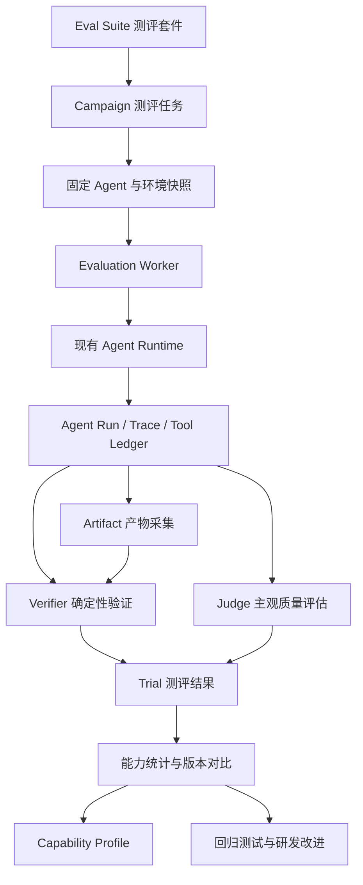

# Agent 测评系统深度重构任务书

> **项目：** general-agent-platform  
> **重构范围：** Agent Evaluation / Capability Assessment  
> **交付对象：** Codex / Trae  
> **任务性质：** 基于现有系统的渐进式重构，不推倒重做  
> **审查基线：** 原审查记录为 `main` 分支，commit `79405691d3f99826153e1b11f3b957f5998060f8`  
> **执行要求：** 开始开发前，必须以当前工作区代码为准重新核实问题和实现状态。

---

## 1. 项目目标

本次重构不是简单增加测评指标或统计图表，而是将现有“数据集执行与结果统计”功能，升级为一套能够评估 Agent 实际能力、定位问题并验证版本改进效果的 **Agent 能力测评系统**。

系统需要回答四个核心问题：

1. **能做什么：** Agent 已经在哪些能力领域、哪些任务复杂度上得到验证？
2. **做得是否稳定：** 单次成功是否具有可重复性，复杂任务能否稳定完成？
3. **为什么失败：** 问题来自 Agent、模型、工具、Runtime、执行环境，还是评分系统？
4. **是否真正进步：** 新版本相较旧版本是否提升，是否引入能力回退？

最终形成以下研发闭环：

```text
定义测评任务
    ↓
固定 Agent 版本与测评环境
    ↓
通过现有 Runtime 执行真实任务
    ↓
保存执行轨迹与最终产物
    ↓
Verifier / Judge 评估结果
    ↓
形成能力画像与版本对比
    ↓
定位短板，沉淀回归用例
    ↓
验证下一版本是否真正改善
```

**本次重构的核心交付是可信的测评结果和可追溯的研发闭环，而不是一个分数展示页面。**

## 2. 当前基础与主要问题

### 2.1 应保留的现有基础

当前项目已经具备一定的测评和 Runtime 能力，本次应优先复用：

- 基于 DeepAgents + LangGraph 的 Agent Runtime。
- Agent Run、事件、工具执行账本和 Checkpoint 等运行记录。
- 数据集、测试用例、历史测评结果及部分快照能力。
- 多轮任务、工具调用检查、Token 和耗时统计。
- 单条测评结果查询、Trace 查看和报告输出。
- Evolution 模块中的运行质量分析与 Judge 能力。

不要为了重构测评系统，再实现一套独立 Agent Loop 或重复建设 Runtime。

### 2.2 原审查中发现的主要问题

以下问题来自此前代码审查记录，执行时必须重新核实，已修复的内容不应重复开发。

| 优先级 | 主要问题 | 影响 |
|---|---|---|
| P0 | 测评创建时没有可靠固定 AgentVersion，Runtime 可能重新获取最新版本 | 同一轮测评中的 Agent 配置可能不一致，版本对比失真 |
| P0 | Benchmark Run 来源没有被可靠标记，可能进入 Evolution 的生产运行统计 | 测评数据与真实用户运行数据混杂 |
| P0 | Agent 执行、结果验证和 Judge 评分状态耦合 | Judge 故障可能被误判为 Agent 失败，甚至丢失已执行结果 |
| P0 | 超时、取消和进程重启后的恢复机制不完整 | 长时间测评可能遗留任务或重复执行 |
| P1 | 以单数据集执行为主，缺少 Suite、Campaign 和重复 Trial | 无法完整评估 Agent，也无法衡量稳定性 |
| P1 | 评分过度依赖 LLM Judge，缺少确定性验证 | 结果容易受到 Judge 模型和提示词影响 |
| P1 | 工程、文档等任务缺少最终产物验证 | 不能证明 Agent 真正完成了任务 |
| P1 | 能力指标、复杂度和样本充分性定义不统一 | 单一分数容易造成误导 |
| P2 | Trace、报告和前端页面承载逻辑较多，失败定位不够直观 | 日常使用和后续维护成本较高 |
| P2 | 数据集编辑、评分配置保存及多数据库 CI 存在待核实问题 | 影响配置可靠性和部署质量 |

此前审查还记录：现有社区数据集约 12 组、168 条用例，其中相当一部分依赖 LLM Judge；工程构建、长文档和科研研究等长程任务的样本较少。数据集数量不等于测评质量，后续应优先提升用例和验证器质量。

## 3. 总体架构与设计原则

### 3.1 目标架构



### 3.2 必须遵循的设计原则

1. **复用 Runtime：** 保留 DeepAgents + LangGraph，测评通过现有 Runtime Service 启动真实 Agent Run。
2. **结果可复现：** 测评开始时固定 Agent 版本、模型配置、工具集、Suite 和环境信息。
3. **执行与评分分离：** Agent 是否完成任务，与验证器或 Judge 是否正常工作，必须分别记录。
4. **证据优先：** 优先通过程序、工具执行结果、状态变化和最终产物验证；LLM Judge 只补充主观质量评价。
5. **区分测评与生产运行：** 标准 Benchmark 与真实用户 Run 可以共享 Trace 和分析能力，但不能混入同一套通过率。
6. **渐进式改造：** 保留现有数据和 API，采用增量迁移，不因重构清空历史结果。
7. **控制基础设施复杂度：** 第一阶段不引入 Kubernetes、分布式 Sandbox 或 Redis 强依赖。

Harbor、Inspect AI、τ-bench 等项目只作为设计参考，吸收其任务、执行环境、验证器、重复测试和结果聚合思想，不要求整体引入为项目依赖。

## 4. 核心功能设计

### 4.1 建立统一的测评组织模型

建议围绕以下概念组织测评，不需要一开始就建设复杂的通用平台：

| 概念 | 作用 |
|---|---|
| Dataset | 保存具体测试用例 |
| Eval Suite | 将多个 Dataset 组合成一套测评标准 |
| Suite Version | 固定一版测评内容，保证历史结果可复现 |
| Campaign | 一次完整的 Agent 测评任务 |
| Trial | 某条测试用例的一次实际执行 |
| Attempt | Trial 因基础设施故障而进行的重试 |
| Grade | Verifier 或 Judge 对 Trial 产生的评分结果 |

一个 Campaign 可以包含多个 Dataset；每条 Case 可以执行多次 Trial。

需要特别区分：

- **重复测评（Trial）：** 为了衡量 Agent 稳定性，主动执行多次。
- **故障重试（Attempt）：** 因模型服务、网络或 Sandbox 等基础设施问题重试。

Agent 自身没有完成任务，不应被当作基础设施故障自动重试，否则会掩盖真实失败。

### 4.2 固定被测 Agent 与环境

Campaign 创建时，应固定一份被测对象快照，至少记录：

- AgentVersion 和对应配置。
- 模型 Provider、模型名称及可获取的模型版本信息。
- System Prompt、Tools、MCP、Skills 等配置摘要。
- Runtime / Harness 版本。
- Memory 策略及知识资源配置。
- 测评环境和必要的 Fixture 信息。

后续即使 Agent 发布了新版本，已创建的 Campaign 也必须继续使用原版本。

Runtime 应支持调用方显式指定 AgentVersion；只有没有指定版本时，才使用现有默认版本解析逻辑。

每条 Trial 使用独立 Session。多轮任务可以在自己的 Session 内共享上下文，但不同 Case 之间不能相互污染。

### 4.3 拆分执行、验证、评分和最终结果

这是本次重构最重要的数据与状态调整。

不要再用一个 `status` 同时表达 Agent 执行结果和评分结果。至少需要区分：

| 状态类别 | 示例 |
|---|---|
| Execution | pending、running、succeeded、agent_failed、timeout、infra_error、cancelled |
| Verification | pending、passed、failed、unscored、error |
| Grading | pending、graded、unscored、error、needs_review |
| Outcome | pass、fail、inconclusive、infra_error、cancelled |

判定原则：

- Agent 完成任务且必要验证通过，结果为 `pass`。
- Agent 执行完成，但明确违反任务要求，结果为 `fail`。
- Agent 已完成，但必要评分服务不可用，结果为 `inconclusive`，保留执行结果。
- 模型服务、Sandbox 等基础设施故障导致任务无法判断，结果为 `infra_error`。
- 没有配置评分器时，应标记为 `unscored`，不能误报为执行失败。

统计 Agent 成功率时，不得把 Judge 故障、Verifier 故障和基础设施故障计入 Agent 失败分母。

### 4.4 建立 Verifier 与 Judge 两层评分体系

**Verifier：验证客观事实。**

优先建设以下验证能力：

- 文本匹配、结构化 JSON 和 Schema 校验。
- 工具选择、工具参数、工具调用顺序验证。
- 禁止动作和约束检查。
- Mock API 或数据库的最终状态验证。
- 文件是否生成、内容是否完整、格式是否正确。
- 代码构建、Lint 和测试结果。
- 文档结构、章节、关键内容和修改结果检查。

**Judge：评价主观质量。**

适用于代码质量、文档可读性、研究质量、推理过程合理性等难以完全程序化验证的内容。

Judge 改造要求：

1. 评价时不仅接收最终回答，还应参考工具调用轨迹、执行结果、错误恢复和最终产物。
2. 优先使用独立 Judge 模型，不要默认复用被测 Agent 的模型配置。
3. Judge 模型、提示词、评分标准和版本应可追溯。
4. Judge 输出需要结构化校验，并给出可定位的证据。
5. Judge 失败不能覆盖 Agent 执行结果；支持对已有 Trial 单独重新评分。
6. 确定性验证器的硬性失败不能被 Judge 的高分覆盖。

第一阶段不必实现复杂的 Judge 自动校准平台，但应预留人工复核和评分版本管理能力。

### 4.5 建立 Agent 能力维度

建议采用八个核心维度组织能力画像：

| 能力维度 | 主要评估内容 |
|---|---|
| 任务理解 | 是否正确理解目标、约束和交付要求 |
| 规划与推理 | 是否能拆解任务、安排步骤和处理依赖 |
| 工具调用 | 工具选择、参数和调用时机是否正确 |
| 多工具协作 | 是否能完成跨工具、跨系统的连续任务 |
| 上下文与记忆 | 多轮任务、长上下文和状态压缩后能否保持关键信息 |
| 异常恢复 | 工具失败、中断后能否修正、恢复和继续执行 |
| 交付能力 | 代码、文档、文件和数据结果是否真正可用 |
| 可靠性与安全 | 重复执行稳定性、约束遵循和禁止动作控制 |

复杂度建议分为四级：

- **L1 基础：** 单轮、目标明确、无工具或简单操作。
- **L2 有界：** 少量推理或工具调用，步骤和依赖简单。
- **L3 复合：** 多步骤、多工具、多轮上下文或多个约束。
- **L4 长程：** 跨阶段任务、动态环境、失败恢复和复杂交付物。

复杂度表示任务难度，能力维度表示任务测量什么，两者不能混为一谈。不能用执行步数、Token 数或工具调用次数直接推断任务复杂度。

### 4.6 指标与能力画像

第一版优先实现以下指标：

- 任务通过率：按 Case、能力维度和复杂度统计。
- `pass@k`：多次尝试中至少一次成功的比例。
- `pass^k`：同一 Case 的 k 次独立执行全部成功的比例，用于观察稳定性。
- 执行成功率、工具调用成功率、异常恢复情况。
- 交付物验证结果。
- p50 / p95 耗时、Token 用量和单个成功任务成本。
- 有效样本数、验证覆盖率和置信区间。

能力画像不能只显示一个综合分数。每个维度都要能看到样本数量、通过情况、稳定性和具体失败案例。

样本不足时，应显示“尚未验证”或“证据不足”，不要强行给出能力等级。重复执行同一 Case 不能简单算成多个独立 Case。

### 4.7 执行环境与交付物验证

不同任务采用合适的执行环境：

- 问答和基础推理：直接通过 Runtime 执行。
- 工具调用和业务流程：使用 Mock Tool / Mock API。
- 多轮和记忆任务：使用独立 Session 和可重置的 Memory Fixture。
- 工程任务：使用隔离 Workspace，执行构建和测试。
- 文档任务：提供原始文件和模板，检查最终文件、结构与内容。
- 研究任务：在受控网络策略下检查来源和证据。

第一版优先使用本地 Docker Sandbox，不建设分布式沙箱集群。

Sandbox 默认禁止任意网络访问，不挂载生产凭据，不允许访问未授权主机目录。任务结束后，应先采集最终文件和测试结果，再清理环境。

特别注意：工具调用记录中出现 `write_file` 或 `edit_file`，不等于最终交付成功。工程和文档任务必须检查最终 Workspace 中的真实产物。

### 4.8 Worker、取消与恢复

测评任务可能持续较长时间，不能只依赖 FastAPI 进程内的 `asyncio.create_task()`。

应建设持久化的 Campaign Worker，复用现有 Runtime Worker 的 Lease、Heartbeat 和恢复设计，但职责要分开：

- Evaluation Worker：负责 Campaign、Trial 的调度和状态管理。
- Agent Runtime Worker：负责真实 AgentRun 的执行和恢复。
- Evaluation Worker 通过 Runtime Service 创建、查询和取消 AgentRun。

服务重启后，应先检查已有 AgentRun 状态，再决定恢复、继续评分或重试，不能直接重新执行所有任务。

超时和取消必须传递到真实 AgentRun。对存在不确定外部副作用的任务，不允许无条件重放。

### 4.9 Trace 与证据留存

每条 Trial 应能追溯到：

- AgentRun 和完整执行状态。
- 模型调用摘要。
- 工具调用、参数、结果和错误。
- 关键状态变化和恢复过程。
- 最终回答与交付物。
- Verifier / Judge 的评分结果及证据。

长任务 Trace 应支持分页和按类型查看。大文件和大 Payload 使用引用方式，不要全部塞入列表接口。

Benchmark 的关键 Trace 和 Artifact 应有独立保留策略，避免普通运行日志清理后，历史测评无法诊断。

## 5. Benchmark 数据集建设

### 5.1 先治理现有数据集

保留现有数据集作为初始基础，不要为了重构直接删除或全部重写。

逐步检查每条 Case：

- 任务目标是否明确。
- 约束是否清楚。
- 预期结果是否可验证。
- 复杂度和能力标签是否合理。
- 是否存在歧义或答案泄漏。
- Verifier 是否真的能区分正确和错误结果。
- 是否需要独立执行环境。

对现有数据集的改进方向：

- 数学与结构化输出：优先采用确定性答案验证。
- Function Calling：验证真实工具调用、参数和执行结果，而不只是检查输出 JSON。
- 指令遵循：尽量采用程序化约束检查。
- 多轮任务：验证跨轮信息保持和最终状态。
- 工具链任务：使用 Mock Tool / Mock API 检查流程和状态。
- 工程任务：验证最终代码、构建和测试。
- 长文档任务：验证文件、结构、内容和修改质量。
- 研究任务：验证来源可追溯性和结论证据。

### 5.2 建设项目自己的能力基准

优先围绕项目真实使用场景补齐：

1. Tool Calling 与多工具协作。
2. 多轮上下文与 Memory。
3. Context Compaction 后的信息保持。
4. 工具失败后的恢复。
5. 长程任务中断与续跑。
6. 文件读写和真实交付。
7. 代码工程构建与测试。
8. 长文档生成和修改。
9. 深度研究与证据引用。
10. 安全约束和对抗输入。

不追求一开始就拥有大量 Case。优先建设少量高质量、可重复、可验证的任务。

## 6. Evolution 与生产运行评估的边界

现有 Evolution 模块可以继续保留，用于分析真实用户运行质量和发现改进机会。

必须明确区分：

- **Benchmark Evaluation：** 固定版本、固定用例、固定环境，用于能力测评和版本回归。
- **Production Run Evaluation：** 真实用户任务，用于运行质量分析、问题发现和候选用例收集。

两者可以复用 Trace、Verifier 和 Judge，但统计结果不能直接混合。

需要为 AgentRun 增加明确的来源标识，例如 `chat`、`workflow`、`evaluation`。Evolution 默认只处理允许的生产来源，不能把 Benchmark Run 当作普通用户运行再次计分。

生产运行中发现的失败案例，可以经过脱敏、人工审核和验证器设计后，转化为正式 Benchmark Case。

## 7. 前端与交互改造目标

前端重点是让使用者看懂 Agent 的能力边界，并能从结果快速定位问题。

建议将当前 Evaluation 页面按职责拆分为以下功能：

| 页面 | 核心用途 |
|---|---|
| 能力总览 | 查看 Agent 当前能力画像、样本覆盖和主要短板 |
| 测评套件 | 管理 Dataset、Suite 和测试用例 |
| 测评任务 | 创建、运行、取消和查看 Campaign |
| 测评报告 | 查看能力维度、复杂度、稳定性和成本结果 |
| Trial 详情 | 查看单条任务的执行、验证、评分和最终结果 |
| Trace 诊断 | 查看模型调用、工具执行、错误和恢复过程 |
| 版本对比 | 比较两个 AgentVersion 的提升和回归 |

交互要求：

- 页面明确显示被测 Agent 版本和测评套件版本。
- 区分 Agent 执行失败、验证失败、Judge 故障和基础设施错误。
- 每个能力结论都能进入对应 Case、Trial 和 Trace。
- 能力画像同时展示样本数量，不能只展示分数。
- 支持查看最终 Artifact。
- 支持基于指定 Suite 执行版本回归。

不要求一次性重做所有视觉细节，先保证信息结构、状态表达和诊断链路清晰。

## 8. 分阶段实施计划

### 阶段 0：代码复核与方案确认

**目标：** 确认当前代码状态，避免对已经修复的问题重复开发。

主要任务：

- 复核 Evaluation、Evolution、Runtime、AgentVersion 和前端代码。
- 逐项核实本任务书列出的问题。
- 梳理当前测评创建、执行、评分和报告的真实调用链。
- 明确新增模型与现有模型的关系。
- 明确 Runtime 版本固定、Run 来源和取消机制。
- 输出简洁的架构设计和数据库迁移方案。

**阶段验收：** 提交现状差距清单、目标架构图和关键设计决策，经确认后再进入主体开发。

### 阶段 1：修复测评可信度问题

**目标：** 先让现有测评结果可信。

主要任务：

- 固定 Campaign 使用的 AgentVersion。
- 为 AgentRun 增加来源标识，隔离 Benchmark 与 Production。
- 拆分执行、验证、评分和最终结果状态。
- 修复 Judge 失败导致结果丢失或误判的问题。
- 正确处理 `unscored`、`inconclusive` 和 `infra_error`。
- 完善超时、取消和底层 AgentRun 状态关联。
- 修复已确认的数据保存、历史关联和数据库迁移问题。

**阶段验收：** 版本不会漂移；Judge 故障不会变成 Agent 失败；Benchmark 不会污染 Evolution；超时和取消能作用于真实 Run。

### 阶段 2：建设 Suite、Campaign 和 Trial

**目标：** 支持完整、可重复、可恢复的 Agent 测评。

主要任务：

- 建设 Eval Suite 和版本管理。
- 建设 Campaign、Case Snapshot、Trial 和 Attempt。
- 支持多个 Dataset 组合成一次 Campaign。
- 支持同一 Case 重复执行。
- 建设持久化 Worker、并发控制、取消和恢复。
- 每条 Trial 关联真实 AgentRun、Trace 和结果。
- 保留旧 API 和历史数据兼容能力。

**阶段验收：** 一次 Campaign 能执行多个 Dataset；能够重复执行；进程重启后可以恢复；不会无条件重复执行已完成的 AgentRun。

### 阶段 3：完善验证、Judge 和交付物能力

**目标：** 从“评价回答”升级为“验证任务是否真正完成”。

主要任务：

- 建设统一 Verifier 注册与执行机制。
- 完成第一批确定性 Verifier。
- 重构 Judge，使其基于完整执行证据评分。
- 支持独立重新评分。
- 建设本地 Docker Sandbox 和 Workspace 隔离。
- 完成工程、文档等任务的最终产物采集与验证。
- 完善 Trace 查询和 Artifact 查看。
- 增加必要的安全和隔离测试。

**阶段验收：** 工具调用任务能验证真实执行；工程和文档任务能检查最终产物；Judge 或 Verifier 故障不会覆盖 Agent 执行结果。

### 阶段 4：能力画像、版本对比与前端完善

**目标：** 让测评结果能够指导 Agent 研发。

主要任务：

- 建立八个能力维度和 L1-L4 复杂度统计。
- 实现通过率、pass@k、pass^k、成本和稳定性指标。
- 展示样本数量、证据覆盖和统计不确定性。
- 建设 Capability Profile。
- 建设 AgentVersion 配对比较和回归报告。
- 完成测评套件、Campaign、报告、Trial 和 Trace 页面拆分。
- 支持失败用例沉淀为回归测试。

**阶段验收：** 能够查看 Agent 能力边界；能比较版本；能从短板定位到失败任务和 Trace；能用同一套 Suite 验证后续版本。

### 阶段 5：数据集治理与工程质量收尾

**目标：** 建立可持续维护的 Benchmark 体系。

主要任务：

- 审核和修复现有数据集。
- 补齐项目真实场景中的高价值 Case。
- 为每条正式 Case 配置有效验证器。
- 增加验证器自身的正例、反例和重复性测试。
- 完善 SQLite、MySQL、PostgreSQL 迁移与 CI。
- 补齐架构、用例编写、Verifier 和运行手册。

**阶段验收：** 默认 Suite 能完整运行并生成报告；关键用例有有效验证器；主要数据库 CI 通过；文档与实现一致。

## 9. 兼容性、安全与非目标

### 9.1 兼容性要求

- 保留现有 Dataset、历史测评结果和必要 API。
- 采用增量数据库迁移，不直接删除旧表。
- 旧测评记录缺少 AgentVersion 时，应标记为版本未知，不要猜测补写。
- 新旧 API 可以通过兼容层逐步迁移。
- 所有新模型和状态字段都需要有对应迁移和测试。

### 9.2 安全要求

- Benchmark 默认使用隔离环境，不直接操作生产系统。
- Hidden Expected、参考答案和验证器内部逻辑不能暴露给被测 Agent。
- Sandbox 默认禁止任意网络访问，不挂载生产凭据。
- Trace、工具参数和 Artifact 展示前应进行敏感信息脱敏。
- 每个 Campaign 和 Trial 都应设置合理的耗时、Token 和资源上限。
- 对外部副作用不确定的任务，不允许自动重放。

### 9.3 本次明确不做

- 不替换 DeepAgents、LangGraph 和现有 Agent Runtime。
- 不重新实现一套 Agent Loop。
- 不强制引入 Harbor 或 Inspect AI 作为运行依赖。
- 不建设 Kubernetes 或分布式 Sandbox 集群。
- 不做模型训练或 Fine-tuning。
- 不建设公开排行榜或商业化 Benchmark 服务。
- 不以单一综合分数替代真实能力证据。

## 10. 最终验收标准

本次重构至少应满足以下要求：

### 测评可信度

- Campaign 固定 AgentVersion、Suite Version 和关键环境信息。
- 每条 Trial 都能关联真实 AgentRun 和执行证据。
- Agent 失败、基础设施失败、Verifier 失败和 Judge 失败能够明确区分。
- 历史结果可查看，必要时可重新评分。
- 不同版本可以在相同用例和条件下进行比较。

### Agent 能力评估

- 一次 Campaign 能组合多个 Dataset。
- 支持重复执行和稳定性统计。
- 能按能力维度和复杂度展示结果。
- 能展示样本量和证据覆盖，不对小样本做过度推断。
- 工程、文档等任务有真实产物验证。

### 研发闭环

- 能从能力短板定位到具体 Case、Trial 和 Trace。
- 能查看新旧版本的提升与回归。
- 能将失败案例沉淀为回归用例。
- 能基于指定 Suite 验证新版本。

### 工程质量

- Campaign 支持持久化执行、取消和恢复。
- 进程重启不会造成无条件重复执行。
- Sandbox 隔离和敏感信息保护有效。
- 数据库迁移和主要 CI 测试通过。
- 前端状态表达清晰，文档与实际实现一致。

## 11. 交付物与执行汇报

### 必须交付

1. Evaluation 新架构及关键数据模型。
2. 数据库增量迁移和兼容方案。
3. Suite、Campaign、Trial 的后端能力。
4. 与现有 Runtime 的版本固定、Run 关联和取消机制。
5. Verifier / Judge 评分体系。
6. Trace、Artifact 和必要的 Sandbox 能力。
7. Capability Profile 与版本对比。
8. 对应的前端页面和交互。
9. 自动化测试及部署说明。

### 每个阶段完成后汇报

- 本阶段实际完成的功能。
- 核心架构和数据流变化。
- 修改的主要文件和数据库迁移。
- 自动化测试命令及真实结果。
- 尚未完成的事项和风险。
- 下一阶段计划。

没有实现或没有测试通过的内容，必须明确标记为未完成，不能仅以页面可访问或接口返回成功作为验收依据。

## 12. 外部设计参考

以下项目用于学习设计思想，不要求直接作为本项目依赖：

- **Harbor：** 任务、执行环境、Verifier、Trial 和 Artifact 的组织方式。  
  https://github.com/harbor-framework/harbor
- **Inspect AI：** Dataset、Solver、Scorer、Sandbox 和评测运行机制。  
  https://inspect.aisi.org.uk/
- **τ-bench：** 通过最终业务状态验证任务，并通过重复执行观察可靠性。  
  https://arxiv.org/abs/2406.12045
- **OpenAI Agent Evals：** Agent 执行轨迹和 Trace Grading 的评估思路。  
  https://developers.openai.com/api/docs/guides/agent-evals
- **OpenAI Trace Grading：** 基于完整执行轨迹而不只是最终回答进行评价。  
  https://developers.openai.com/api/docs/guides/trace-grading

---

## 最终设计原则

**先保证测评可信，再扩展测评规模；先验证真实任务结果，再讨论 Agent 能力分数；先打通失败定位和版本回归，再建设更复杂的自动化分析。**

本次重构应以最小必要复杂度，建立一套能够长期服务于 Agent 开发、评估和持续改进的测评系统。
