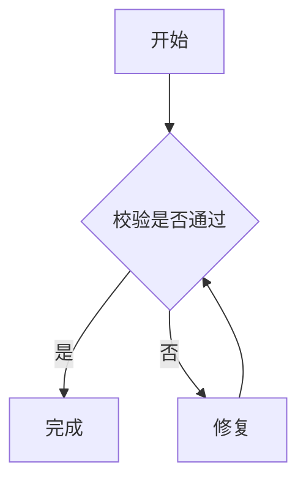

# General Agent Platform：对话区图表与富内容渲染调研及实施方案

> 调研日期：2026-11-26\
> 仓库：`xxiaoxiong/general-agent-platform`\
> 范围：智能体对话消息中的 Markdown 表格、Mermaid 流程图、常见数据图表\
> 当前状态：完成调研与方案设计；**尚未实施代码变更。**

## 1. 调研结论

建议采用"**保留 Markdown 基础渲染 + Mermaid 专用图形渲染 + ECharts
数据图表渲染**"的组合方案。

  ------------------------------------------------------------------------------------------------------------
  内容类型                           推荐格式             渲染方式          本次处理
  ---------------------------------- -------------------- ----------------- ----------------------------------
  普通文本、标题、列表、引用、代码   Markdown             Marked +          保留
                                                          DOMPurify         

  表格                               GFM Markdown Table   现有 HTML         保留并补齐测试、响应式和大表性能
                                                          表格渲染          

  流程图、架构图、时序图、ER 图      `mermaid` 代码围栏   Mermaid → SVG     新增

  柱状图、折线图、面积图、饼图       `chart` JSON         ECharts           新增
                                     代码围栏                               

  普通代码块                         常规代码围栏         现有 CodeBlock    不改变

  任意 HTML / JavaScript             不作为模型输出协议   不执行            禁止
  ------------------------------------------------------------------------------------------------------------

核心原则：

1.  图表直接出现在原始助手消息的位置，不跳转到单独页面。
2.  流式输出期间不尝试渲染不完整图表；显示明确的生成中状态。
3.  流式结束后再渲染；语法错误或数据校验失败时显示可复制的原始源码和错误提示。
4.  用户始终可以切换查看图表与源码。
5.  Mermaid、ECharts 按需加载，资源随前端构建产物本地部署，不依赖运行时
    CDN。
6.  模型输出只作为不可信数据；不执行模型生成的 HTML、JavaScript 或任意
    ECharts 配置函数。
7.  只改变前端展示，不改写服务端持久化的原始消息、SSE 事件和会话历史。

## 2. DeepSeek Harness 调研

### 2.1 核心渲染机制

DeepSeek Harness 的 Web Chat 使用 `MarkdownText` 作为 Markdown
渲染入口。当前代码围栏扩展机制通过：

``` text
MarkdownText
  → renderNode
    → renderCode
      → conversation.chat.markdown.fence
        → 按语言分派扩展渲染器
```

代码围栏扩展槽的关键属性：

-   根据围栏语言分派渲染器；
-   将源码、语言、流式状态和 meta 信息传给扩展；
-   流式阶段可以继续显示普通代码块；
-   图表渲染器失败时可以保留普通代码块；
-   不认识的语言继续走默认代码渲染。

需要注意：**DeepSeek Harness 核心 Markdown
渲染与社区图表插件不是一回事。** Mermaid
渲染在社区插件中有多种实现；不能简单认为安装 DSH 后所有 Mermaid
图表都天然由核心内置渲染。

### 2.2 值得借鉴的能力

-   Mermaid 图表卡片：图表 / 源码切换、复制源码、主题适配、缩放和全屏。
-   失败降级：语法错误时保留源码，而不是出现空白块。
-   按需加载：Mermaid 等较重的渲染引擎不进入初始加载主包。
-   流式控制：未完成的代码围栏不进行最终图表渲染。
-   表格性能：近期 DSH 版本专门优化了长会话和大型 Markdown
    表格、列表引起的卡顿。
-   扩展点：按语言挂接代码围栏渲染器，而不是用全局 DOM MutationObserver
    改写整个页面。

### 2.3 参考项目

  -------------------------------------------------------------------------------------------------------------------------------
  项目                    可借鉴内容                                             不建议照搬的部分
  ----------------------- ------------------------------------------------------ ------------------------------------------------
  `dsh-mermaid-smooth`    Mermaid                                                DSH 插件的 Cordis 接入方式
                          11、离线资源、严格安全级别、源码切换、缩放、主题适配   

  `dsh-artifact`          ECharts + Mermaid 双引擎、真实图表交互、纯 JSON        本次不需要完整工具调用协议和 3D / HTML 沙箱
                          数据边界                                               

  `dsh-table-charts`      在 Markdown 表格附近提供数据可视化                     自动猜测所有表格的图表语义，容易产生不准确的图

  DSH 原生 Markdown fence 按语言分派、流式降级、默认代码块兜底                   React 实现本身
  slot                                                                           
  -------------------------------------------------------------------------------------------------------------------------------

调研来源：

-   DeepSeek Harness
    Releases：<https://github.com/deepseek-ai/deepseek-harness/releases>
-   DeepSeek Harness Chat
    README：<https://github.com/deepseek-ai/deepseek-harness/tree/master/packages/client/ui-chat>
-   DeepSeek Harness
    Slots：<https://github.com/deepseek-ai/deepseek-harness/blob/master/docs/subsystems/slots.md>
-   Mermaid
    渲染需求讨论：<https://github.com/deepseek-ai/deepseek-harness/discussions/1065>
-   Mermaid fence
    扩展机制：<https://github.com/deepseek-ai/deepseek-harness/discussions/6502>
-   Mermaid Smooth：<https://github.com/gitByteFree/dsh-mermaid-smooth>
-   DSH Artifact：<https://github.com/sumarilkkxx/dsh-artifact>
-   DSH Table Charts：<https://www.dsh.so/artifact/dsh-table-charts/>

## 3. 当前 General Agent Platform 代码基线

已检查当前默认分支中的前端入口和消息渲染代码。

### 3.1 现有技术栈

`frontend/package.json` 当前包含：

-   Vue 3 + TypeScript + Vite
-   `marked` 12
-   `dompurify` 3.3
-   `highlight.js`
-   Element Plus

当前没有直接声明 Mermaid 或 ECharts 依赖。

### 3.2 关键文件

  ---------------------------------------------------------------------------------------------------------------------
  文件                                               当前职责                   调研结论
  -------------------------------------------------- -------------------------- ---------------------------------------
  `frontend/src/views/workspace/WorkspaceHome.vue`   对话消息布局与消息块渲染   助手文本通过 `MessageMarkdown`
                                                                                渲染；当前没有向其传递 `m.streaming`

  `frontend/src/features/run/MessageMarkdown.vue`    Markdown 消息展示          使用 `v-html` 展示 HTML，并通过
                                                                                DOMPurify 清理

  `frontend/src/features/run/messageMarkdown.ts`     Marked 解析与 HTML 生成    所有代码围栏当前都生成普通代码块；GFM
                                                                                表格已经能够解析

  `frontend/src/lib/theme.ts`                        全局主题状态               已有 light / dark
                                                                                响应式主题，可供图表组件使用

  `frontend/package.json`                            前端依赖与测试命令         `npm test` 使用 Node
                                                                                内置测试运行器；构建命令执行 `vue-tsc`
                                                                                和 Vite build
  ---------------------------------------------------------------------------------------------------------------------

### 3.3 当前已经具备的能力

**Markdown 表格已经有基础支持，不需要重新引入表格解析库。**

`messageMarkdown.ts` 已启用 GFM，并将表格包装为 `.table-scroll`
容器。`MessageMarkdown.vue` 也有相应的横向滚动样式。

当前代码围栏的处理逻辑是统一生成普通代码块，因此 `mermaid` 或图表 JSON
目前没有专用渲染路径。

### 3.4 本次改造最重要的技术约束

当前 `MessageMarkdown.vue` 的核心输出方式是：

``` vue
<div class="response-markdown" v-html="html"></div>
```

而 `messageMarkdown.ts` 中的 Marked `renderer.code` 是同步生成 HTML
字符串的。

这意味着：

-   不能只在代码围栏回调里调用 Vue 组件；
-   不能直接把 ECharts 图表组件当作普通 HTML 字符串输出；
-   Mermaid 和 ECharts 都涉及异步加载、生命周期和渲染状态；
-   如果采用占位节点 +
    子组件挂载，必须明确管理挂载、更新、卸载，不能依赖全局 DOM 扫描；
-   也可以考虑将消息渲染改成 Vue VNode / AST 组件树，但必须避免破坏现有
    Markdown 解析效果。

建议先做最小的渲染扩展层，保留当前 Marked + DOMPurify 主流程。Codex
应先评估"受控占位节点挂载"和"AST/VNode
渲染"两种方式，选择生命周期更清晰、回归风险更低的一种。禁止用全局
MutationObserver 作为主要实现方案。

## 4. 推荐目标架构

``` text
WorkspaceHome.vue
  │
  ├── 消息块 text
  │
  ▼
MessageMarkdown.vue
  │
  ├── text
  ├── streaming
  └── theme
  │
  ▼
Message Markdown Renderer
  │
  ├── Markdown / GFM
  │     ├── 段落、标题、列表
  │     ├── 表格
  │     └── 普通代码块
  │
  ├── Mermaid Fence
  │     └── MermaidBlock.vue
  │           └── Mermaid → SVG
  │
  └── Chart Fence
        └── ChartBlock.vue
              └── ECharts
```

建议新增的模块：

``` text
frontend/src/features/run/
  MessageMarkdown.vue
  messageMarkdown.ts
  rich-content/
    registry.ts
    types.ts
    validateChartSpec.ts
    MermaidBlock.vue
    ChartBlock.vue
    renderQueue.ts          # 如实际并发渲染测试证明需要，再引入
```

模块职责：

-   `registry.ts`：语言别名与渲染器类型注册。
-   `types.ts`：Mermaid / Chart 的类型定义。
-   `validateChartSpec.ts`：对模型输出的 JSON 进行结构和数值校验。
-   `MermaidBlock.vue`：异步加载 Mermaid、生成 SVG、源码切换、错误降级。
-   `ChartBlock.vue`：异步加载 ECharts、绘图、响应式 resize、实例
    dispose。
-   `MessageMarkdown.vue`：统一协调消息内容、流式状态、主题和富内容组件生命周期。

目录可按当前项目结构调整，不要求机械采用上述目录。

## 5. 功能协议设计

### 5.1 Mermaid 流程图

模型使用标准代码围栏：

```` markdown

````

建议识别的语言别名：

-   `mermaid`
-   `mmd`
-   `mermaidjs`

第一版优先支持 Mermaid 常用图种：

-   flowchart / graph
-   sequenceDiagram
-   classDiagram
-   stateDiagram
-   erDiagram
-   gantt
-   mindmap
-   pie
-   xychart-beta
-   timeline

具体支持范围以选定的 Mermaid 版本为准，并由真实测试样例验证。

### 5.2 数据图表

建议增加一个简单、稳定、模型容易生成的 `chart` JSON 协议，不直接暴露完整
ECharts Option。

示例：

```` markdown
```chart
{
  "type": "bar",
  "title": "月度收入",
  "labels": ["1月", "2月", "3月", "4月"],
  "series": [
    {
      "name": "收入",
      "data": [120, 150, 135, 180]
    }
  ],
  "unit": "万元"
}
```
````

第一版支持：

-   `bar`：柱状图
-   `line`：折线图
-   `area`：面积图
-   `pie`：饼图
-   `stacked_bar`：堆叠柱状图

建议后续再扩展散点图、雷达图、热力图等。

协议校验要求：

-   `type` 必须属于白名单；
-   `labels` 与每个 `series.data` 长度匹配；
-   数据只能是有限数值；
-   限制系列数量、数据点数量、标题和标签长度；
-   饼图只能使用合法的单系列数据；
-   非法 JSON、未知类型、缺失字段和不匹配数据均明确报错；
-   不允许模型直接提供 JavaScript 函数、任意 HTML、任意 ECharts Option
    或 formatter。

### 5.3 Markdown 表格

继续使用 GFM Markdown：

``` markdown
| 模块 | 技术 | 用途 |
|---|---|---|
| 前端 | Vue 3 | 页面交互 |
| 后端 | FastAPI | API 服务 |
| Runtime | LangGraph | 状态与流程 |
```

本次不重复开发表格解析器，重点改善：

-   长表格横向滚动；
-   移动端布局；
-   长文本和长代码不撑破气泡；
-   表头、对齐、行间距和主题；
-   大表格的滚动与渲染性能；
-   必要时提供表格折叠或展开，但不能静默丢弃行。

## 6. 渲染交互要求

### 6.1 Mermaid 图表卡片

至少具备：

-   默认显示图表；
-   图表 / 源码切换；
-   复制 Mermaid 源码；
-   放大查看；
-   适应容器宽度；
-   浅色 / 深色主题跟随；
-   解析失败显示错误状态和原始源码。

### 6.2 ECharts 图表卡片

至少具备：

-   标题、图例、坐标轴和单位；
-   鼠标悬停 Tooltip；
-   多系列图表；
-   响应式尺寸调整；
-   查看图表数据的辅助表格；
-   源数据 / 图表切换；
-   主题切换；
-   错误状态和源码查看。

### 6.3 流式输出

这是本次最重要的质量要求之一。

建议将 `streaming` 状态传入 `MessageMarkdown.vue`：

-   流式阶段：不执行 Mermaid / ECharts
    最终渲染；显示"图表生成中"占位状态，不把未完成的图表源码直接展示为普通代码。
-   流式结束：识别并渲染完整图表。
-   渲染失败：回退为原始代码块，显示简短错误提示。
-   历史会话：加载时直接渲染已完成的图表。
-   多个图表：每个图表有独立实例和唯一 ID。
-   同一消息更新或组件卸载：销毁旧实例，避免重复挂载、事件泄漏和内存泄漏。

不要在每个 token 到达时反复初始化 Mermaid 或 ECharts。

## 7. 安全与稳定性要求

### 7.1 Mermaid

-   使用 `securityLevel: "strict"`；
-   不允许启用不可信的 HTML 标签和点击事件；
-   生成的 SVG 必须经过 DOMPurify 的 SVG 安全处理；
-   禁止未经清理的 SVG 直接写入 DOM；
-   限制源码大小和图表复杂度；
-   对解析失败、渲染超时和资源加载失败提供降级；
-   禁止使用远程 CDN 作为运行时唯一资源来源。

Mermaid
官方安全说明：<https://mermaid.js.org/config/schema-docs/config-properties-securitylevel.html>

### 7.2 ECharts

-   不直接接收模型提供的完整 ECharts Option；
-   将受限的 `ChartSpec` 映射成前端内部 ECharts Option；
-   禁止 formatter 函数、任意 HTML tooltip、脚本和自定义执行入口；
-   仅启用第一版实际需要的图表类型和组件；
-   使用 `ResizeObserver` 处理容器尺寸变化；
-   组件卸载时执行 `dispose()`；
-   限制数据点、系列数和输入长度。

ECharts
官方明确说明其不会替调用方自动清理不可信输入，应在应用层处理安全边界。

参考：<https://echarts.apache.org/handbook/en/best-practices/security/>

### 7.3 资源部署

-   Mermaid、ECharts 采用动态 import；
-   使用 Vite 分包；
-   只在对应图表首次出现时加载对应资源；
-   资源由前端构建产物本地提供；
-   不依赖运行时访问外部 CDN；
-   Docker 离线部署仍能正常渲染。

## 8. 模型输出规范

需要补充智能体的输出指导，使模型知道何时使用哪一种格式。

  用户需求                           推荐输出
  ---------------------------------- ---------------
  解释执行流程、系统架构、调用关系   Mermaid
  比较多个产品或方案                 Markdown 表格
  分析数量、趋势、占比               Chart JSON
  普通知识问答                       Markdown 文本
  代码实现和源码展示                 普通代码块

提示词必须强调：

1.  只有图表确实能提升理解时才输出图表。
2.  流程关系优先 Mermaid，不要手工输出 SVG 或 HTML。
3.  数值分析优先使用 `chart` 协议，不要将 ECharts
    原始配置直接暴露给前端。
4.  图表标题、单位、标签、数据必须与正文结论一致。
5.  数据不足时不要编造数据；可以明确说明无法绘制。
6.  图表前后保留必要的文字说明，不要让回答只剩图表源码。
7.  普通代码块不能误识别为图表。

提示词变更需要通过真实模型输出测试，而不是只验证静态示例。

## 9. 多场景测试矩阵

**必须覆盖单元测试、组件测试和真实浏览器 E2E。** 仅仅验证
`marked.parse()` 返回了 HTML 不足以证明图表能正常显示。

### 9.1 Markdown 与表格

  场景                                 验收重点
  ------------------------------------ ----------------------
  普通段落、标题、列表、引用           原有 Markdown 不回归
  标准 GFM 表格                        正确显示为表格
  中文、英文混合表格                   字符不乱码、列宽正常
  表格单元格内含粗体、链接、行内代码   格式正确
  长文本、长 URL、长代码               不撑破消息气泡
  宽表格、窄屏                         在表格自身区域滚动
  100 行以上表格                       不明显卡顿
  超大表格压力测试                     不阻塞整个聊天页面
  普通文本中的 `|`                     不误识别为表格

### 9.2 Mermaid 图表

  场景                   验收重点
  ---------------------- ----------------------------
  flowchart TD / LR      节点、连线和分支正确
  graph TD / LR          兼容旧语法
  sequenceDiagram        参与者、消息、返回关系正确
  classDiagram           类和关系正确
  stateDiagram           状态与转移正确
  erDiagram              实体关系正确
  gantt                  时间轴布局正确
  mindmap                层级关系正确
  pie / xychart-beta     数据图正确
  timeline               时间线布局正确
  两个及以上图表同消息   ID 不冲突、互不覆盖
  相同源码重复出现       不出现 SVG ID 冲突
  错误语法               显示源码与错误状态
  空源码、超长源码       不白屏、不卡死
  非 Mermaid 代码        不误触发图表渲染

### 9.3 ECharts 图表

  场景               验收重点
  ------------------ ----------------------
  柱状图             分类和值正确
  折线图             趋势、坐标轴正确
  面积图             面积填充正确
  饼图               标签、占比和图例正确
  堆叠柱状图         系列堆叠正确
  多系列数据         图例与颜色正确
  负数、零值、小数   数值正确
  长标签、长标题     不重叠、不溢出
  空数据             显示空状态
  非法 JSON          回退源码
  数据长度不匹配     校验失败，不画错误图
  非法数值           拒绝 NaN / Infinity
  超出数据上限       明确提示，不卡死

### 9.4 混合消息

必须验证以下真实消息组合：

1.  普通文本 + Markdown 表格。
2.  普通文本 + Mermaid 流程图。
3.  普通文本 + ECharts 图表。
4.  Markdown 表格 + ECharts 图表。
5.  Mermaid + ECharts + 普通代码块。
6.  多个 Mermaid 图表 + 多个图表 JSON。
7.  图表位于列表或引用块中。
8.  同一条回答中出现普通 JSON 代码与 Chart JSON。
9.  图表渲染失败后，后续正文仍正常显示。
10. 长篇回答中间出现图表，前后文本顺序不改变。

### 9.5 流式与历史回放

1.  逐 token 输出 Mermaid 围栏。
2.  输出尚未结束时切换会话。
3.  停止生成后保留未完成内容。
4.  正常结束后渲染最终图表。
5.  历史会话重新加载后恢复图表。
6.  重新生成回答后替换旧图表。
7.  一条消息内连续输出多个图表。
8.  同一消息反复更新时不重复创建图表实例。
9.  页面切换、组件卸载后释放实例。
10. 网络断开后重新连接，历史图表仍能恢复。

### 9.6 主题与屏幕尺寸

-   浅色 / 深色主题；
-   1440px 桌面；
-   1024px 窄桌面；
-   768px 平板；
-   390px 手机；
-   侧栏展开 / 收起；
-   预览面板打开 / 关闭；
-   浏览器窗口连续调整大小；
-   全屏图表打开 / 关闭；
-   图表缩放、滚动和复制源码。

### 9.7 安全测试

-   Mermaid HTML 标签和脚本注入；
-   Mermaid click / 外部链接；
-   SVG `foreignObject`、事件属性和危险 href；
-   Markdown 原始 HTML；
-   `javascript:` 链接；
-   Chart JSON 中未知字段和不支持的配置；
-   超长输入和复杂图表压力；
-   非法输入不能执行任何模型提供的代码。

### 9.8 性能与资源测试

-   初始主包不包含完整 Mermaid / ECharts 引擎；
-   首次出现 Mermaid 时才加载 Mermaid chunk；
-   首次出现 chart 时才加载 ECharts chunk；
-   同一消息多个图表不能造成明显主线程阻塞；
-   反复切换会话和重新加载不产生图表实例泄漏；
-   不依赖外部 CDN，断网仍能使用；
-   大型表格不能明显阻塞消息滚动。

## 10. 自动化测试策略

当前前端 `npm test` 使用 Node
内置测试运行器，不能仅依赖它验证浏览器实际布局。

建议分层：

  ----------------------------------------------------------------------------------------
  测试层                  工具                    目标
  ----------------------- ----------------------- ----------------------------------------
  单元测试                Node test               语言识别、ChartSpec 校验、Markdown 解析

  组件测试                Vue 测试环境            流式状态、错误降级、主题和组件生命周期

  浏览器 E2E              Playwright              SVG / Canvas
                                                  实际渲染、布局、滚动、交互、复制

  构建测试                `npm run build`         类型、动态分包和离线资源

  回归测试                固定 Markdown fixtures  避免现有 Markdown 输出结构被意外改变
  ----------------------------------------------------------------------------------------

要求：

-   记录真实浏览器控制台错误；
-   对核心图表场景保存截图或视觉回归基线；
-   检查 SVG / Canvas 是否真实生成，而不是只检查源码是否存在；
-   对错误输入检查 fallback；
-   对组件卸载检查 ResizeObserver 和 ECharts 实例释放；
-   如果仓库没有现成的 Playwright 测试环境，增加独立 E2E
    命令，不要让普通 `npm test` 依赖下载浏览器才能运行。

## 11. 推荐实施阶段

### Phase 0：现状基线

-   固定当前 Markdown 输出 DOM fixtures。
-   记录表格、代码块、链接、引用、图片的当前行为。
-   明确消息流式状态传递路径。
-   建立基础测试样例。

### Phase 1：渲染扩展层与表格回归

-   给 `MessageMarkdown` 增加流式状态。
-   建立按语言分派的富内容渲染扩展点。
-   保留原 Markdown 和代码块行为。
-   完成表格测试和布局优化。

### Phase 2：Mermaid

-   接入 Mermaid 本地动态加载。
-   完成 SVG 安全清理。
-   实现图表 / 源码切换、复制、缩放和错误降级。
-   完成常见图种和流式测试。

### Phase 3：ECharts

-   接入 ECharts 按需加载。
-   建立受限 ChartSpec JSON 协议。
-   实现 bar / line / area / pie / stacked_bar。
-   实现响应式 resize、dispose、数据查看和主题适配。

### Phase 4：模型输出规范

-   增加模型使用 Mermaid 和 ChartSpec 的提示词规则。
-   使用多个模型进行真实输出验证。
-   修复模型生成格式与解析协议之间的兼容问题。

### Phase 5：全面验收

-   完成单元、组件、E2E 测试。
-   完成离线 Docker 构建和部署验证。
-   完成多屏幕、浅色 / 深色和性能测试。
-   输出测试结果和未覆盖风险。

## 12. 最终验收标准

不能以"页面没有报错"或"依赖安装成功"作为完成标准。

必须满足：

1.  Markdown 表格正常渲染，原有 Markdown 行为不回归。
2.  Mermaid 常用图种能在对话气泡内正确显示。
3.  ChartSpec 能稳定渲染指定的常见数据图表。
4.  普通代码块不被误判为图表。
5.  流式结束后图表自动渲染，不需要刷新页面。
6.  历史会话重新加载后图表仍能正常显示。
7.  非法源码不会导致空白消息或整个页面崩溃。
8.  失败时源码始终可查看、可复制。
9.  浅色 / 深色、窄屏 / 宽屏都能正常展示。
10. Mermaid 和 ECharts 不进入初始主包，不依赖 CDN。
11. 没有模型生成代码执行、XSS 和 SVG 注入问题。
12. ECharts 实例、监听器和观察器能正确释放。
13. 混合内容、多图表、长表格、流式更新的 E2E 测试全部通过。
14. 提供真实浏览器测试报告和截图，不以静态 HTML 字符串测试代替。

## 13. 参考资料

### DeepSeek Harness

-   Releases：<https://github.com/deepseek-ai/deepseek-harness/releases>
-   Chat
    UI：<https://github.com/deepseek-ai/deepseek-harness/tree/master/packages/client/ui-chat>
-   Slots：<https://github.com/deepseek-ai/deepseek-harness/blob/master/docs/subsystems/slots.md>
-   Mermaid
    需求讨论：<https://github.com/deepseek-ai/deepseek-harness/discussions/1065>
-   Mermaid fence
    HOC：<https://github.com/deepseek-ai/deepseek-harness/discussions/6502>

### Mermaid

-   API Usage：<https://mermaid.js.org/config/usage>
-   Security
    Level：<https://mermaid.js.org/config/schema-docs/config-properties-securitylevel.html>

### ECharts

-   Official Handbook：<https://echarts.apache.org/handbook/en/>
-   Dataset：<https://echarts.apache.org/handbook/en/concepts/dataset/>
-   Chart Size / Resize /
    Dispose：<https://echarts.apache.org/handbook/en/concepts/chart-size/>
-   Security：<https://echarts.apache.org/handbook/en/best-practices/security/>

### Marked

-   Extensions：<https://marked.js.org/using_pro>

------------------------------------------------------------------------

**本方案建议先评审并确认，再进入代码实施。第一优先级不是增加图表数量，而是确保消息渲染链路、流式状态、源码降级和组件生命周期可靠。**
