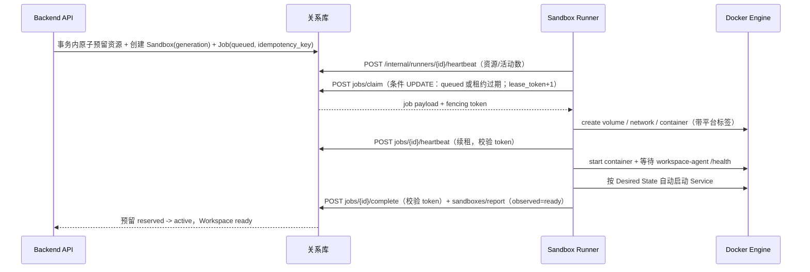

# Workspace Sandbox Runtime 架构设计

> 目标：每个 Project 拥有长期持久化 Workspace；Agent 在隔离 Docker Sandbox 中执行命令、
> 读写项目文件、运行前端/后端 Service；用户可在对话工作区 Preview 区域看到真实页面；
> 单节点先行，多 Runner 可扩展；文件、容器、服务、预览与配额严格隔离并可恢复。

## 1. 服务边界

```text
Frontend (Vue)
  Chat / Files / Preview iframe / Services
        │ /api/v2/projects /api/v2/workspaces
        ▼
Control Plane（现有 Backend，Uvicorn）
  Auth + Project ACL
  Workspace / Sandbox Manager / Scheduler / Reservation
  Service Registry / Preview Grant / Event & Audit
  Run Worker（DeepAgents + LangGraph + Checkpoint）
  SandboxFilesBackend（文件工具 -> workspace-agent）
        │ 内部 Runner API（X-Runner-Token）
        ▼
Sandbox Runner（独立进程，唯一持有 Docker Socket）
  Docker Provider / Job Executor / Reconciler / Gateway
        │ Docker Engine API（unix socket）
        ▼
workspace-sandbox 容器（每 Project 一个活动 Generation）
  workspace-agent :19999（命令 / 文件 / Service / 日志）
  /workspace（Docker Named Volume，容器删除不删卷）
         ▲
         │ Runner Gateway（HTTP / WebSocket，服务令牌）
Preview Proxy（独立服务）
  Preview Grant 校验 / subdomain 路由 / HTTP+WS 转发 / 限流
```

- Backend、Preview Proxy、Sandbox 均不挂载 Docker Socket；只有 Runner 持有。
- Runner 不执行用户代码；用户命令只落在 Sandbox 内。
- Preview Proxy 只代理「已登记 Sandbox + Port」，不接受任意 upstream URL。

## 2. ER 模型

```mermaid
erDiagram
  users ||--o{ projects : owns
  projects ||--o{ project_members : has
  projects ||--|| workspaces : "1:1"
  workspaces ||--o{ sandbox_instances : generations
  workspaces ||--o{ workspace_services : runs
  workspaces ||--o{ preview_grants : authorizes
  workspaces ||--o{ sandbox_command_operations : executes
  sandbox_instances ||--o{ sandbox_jobs : provisions
  sandbox_runners ||--o{ sandbox_instances : hosts
  sandbox_runners ||--o{ sandbox_resource_reservations : reserves
  sandbox_instances ||--o{ workspace_services : contains
  sandbox_instances ||--o{ preview_grants : exposes
  agent_sessions }o--|| projects : "optional project_id"

  projects {
    int id PK
    string name
    int owner_id FK
    string status
  }
  workspaces {
    int id PK
    int project_id FK_UK
    string volume_id
    string status
    int current_sandbox_id
    string write_lease_owner
    int write_lease_token
    datetime write_lease_expires_at
  }
  sandbox_instances {
    int id PK
    int workspace_id FK
    int generation
    int runner_id FK
    string container_id
    string container_ip
    string desired_state
    string observed_state
    int lifecycle_version
  }
  sandbox_jobs {
    string id PK
    string job_type
    string status
    string idempotency_key UK
    string lease_owner
    int lease_token
  }
  sandbox_runners {
    int id PK
    string node_name UK
    string status
    int cpu_allocatable_millis
    int cpu_reserved_millis
    int memory_allocatable_bytes
    int memory_reserved_bytes
  }
  sandbox_resource_reservations {
    int id PK
    int runner_id
    int workspace_id
    string status
    string reservation_token UK
  }
  workspace_services {
    int id PK
    int workspace_id FK
    int sandbox_id FK
    string name
    int port
    string desired_state
    string observed_state
  }
  preview_grants {
    int id PK
    string token_hash
    int sandbox_id
    int port
    datetime expires_at
  }
```

## 3. Sandbox Generation 与状态机

```text
SandboxInstance.observed_state:
  queued -> provisioning -> starting -> ready
                                   ↘ failed
  ready -> stopping -> stopped
  ready -> failed
  any -> recovering -> starting

SandboxInstance.desired_state: running / stopped / deleted
```

约束：

- `(workspace_id, generation)` 唯一；每个 Workspace 同时最多一个活动 Generation。
- 容器标签：`platform.managed=true`、`platform.workspace_id`、`platform.sandbox_id`、
  `platform.generation`；不得仅凭容器名识别归属。
- Desired 与 Observed 分离；Reconciler 按标签对账，未知容器只隔离告警不自动接管。

```text
WorkspaceService.observed_state:
  created -> starting -> healthy -> unhealthy -> exited / failed / stopping -> stopped
WorkspaceService.desired_state: running / stopped
```

## 4. Job / Lease / Fencing 时序



- Lease 过期：Job 回到 queued（`attempt+1`，超过 `max_attempts` 则 failed），旧 token 的
  heartbeat/complete 一律拒绝（Fencing）。
- 幂等：`idempotency_key` 唯一；Provision 前按标签查找同一 Generation：
  - 已存在且配置一致 → 接管并更新状态；
  - 已存在但配置不一致 → `failed / needs_reconciliation`，不静默覆盖；
  - 不存在 → 创建并写标签。
- Docker 创建成功但 DB 提交失败：Job 重试时按标签重新发现容器。

## 5. 资源调度

```text
allocatable = host_total
            - SANDBOX_CPU_RESERVE / SANDBOX_MEMORY_RESERVE / SANDBOX_DISK_RESERVE
available   = allocatable
            - sum(active + reserved reservations)

筛选：status=online 且非 draining、能力匹配、available >= profile.request
评分：剩余 CPU / 内存 / 磁盘、活动 Sandbox 数、镜像缓存
预留：数据库事务 + Runner 行锁（CAS 等价），reserved 计数 + 预留记录同时提交
```

- 预留状态：`reserved -> active -> releasing -> released`；重复释放幂等，计数不得为负。
- 配额：Tenant（当前等价用户）CPU/RAM/Disk 总量、用户最大活动 Sandbox 数、
  Project 最大 Service / Port 数、Sandbox CPU/RAM/PID/Disk 限制、命令时长与输出上限。
- 资源不足：Provision 返回排队状态（Job 保持 queued），超时未满足返回明确错误；
  不无限创建容器。

## 6. 写租约（同一 Workspace 串行写）

- `workspaces.write_lease_owner / write_lease_token / write_lease_expires_at / write_lease_heartbeat_at`。
- 写类 Agent Run（会执行命令/写文件）在开始前 CAS 获取租约；心跳续租；
  结束/失败释放；崩溃后租约过期方可被接管，token 单调递增，旧持有者写入被拒绝。
- 只读工具不获取租约；`execute_command`、`write_file`、`edit_file`、`delete`、
  `start_service` 等视为潜在写操作。

## 7. Preview 链路

```text
Browser iframe
  -> http://{token}.{PREVIEW_BASE_DOMAIN}:8081/
  -> Preview Proxy：解析子域 token -> SHA256 查 preview_grants
       校验：未撤销、未过期、Sandbox Generation 匹配、Port 已登记
  -> Runner Gateway（X-Runner-Token）
  -> Sandbox container_ip:port
```

- 本地开发：`*.localhost` 由浏览器解析到回环地址，天然不同 Origin；
  生产：`PREVIEW_BASE_DOMAIN=preview.example.com` + TLS + 独立域名。
- 代理支持 HTTP 流式与 WebSocket（Vite HMR）；重写 Host / X-Forwarded-*；
  设置 CSP、Referrer-Policy、X-Content-Type-Options；不转发平台 Cookie。
- Token 只存 SHA256；可过期、可撤销；不能用于命令执行或文件管理。
- 兜底路径：`http://{host}:8081/p/{token}/...`（子域不可用时）。

## 8. 安全边界与网络拓扑

- Sandbox 容器：
  - 非 root（镜像内 `sandbox` 用户），`privileged=false`、`cap_drop=ALL`、
    `no-new-privileges`、seccomp 默认、只读 rootfs + `/tmp` tmpfs；
  - CPU quota / Memory limit / PIDs limit / ulimit；日志轮转；
  - 仅挂载自己的 Named Volume 到 `/workspace`；不映射宿主机端口；
  - 每个 Sandbox 独立 bridge network（`gap-net-{sandbox_id}-g{generation}`），
    Runner 以网关身份加入；Sandbox 之间不可互通；
  - 不加入 Compose `default` 网络，无法解析 `mysql/redis/backend` 服务名；
  - 出站公网用于依赖下载；`SANDBOX_NETWORK_POLICY=none` 时创建 internal 网络完全断网。
  - 已知限制：Docker bridge 无法按容器阻断宿主机 LAN/元数据地址；生产需配合宿主机
    防火墙或 Egress Proxy（文档注明）。
- Runner：
  - 只接受带 `X-Runner-Token` 的内部请求；Job payload 白名单字段；
  - 镜像、Volume、Network、Mount、SecurityOpt 全部由服务端策略生成；
  - 不接受模型/用户传入 HostConfig、宿主机路径、任意镜像；
  - 管理 API 只监听 Compose 内网（不映射宿主机端口）。
- Backend / Preview Proxy / Sandbox 均无 Docker Socket。

## 9. 事件与审计

- `sandbox_events` 记录：Workspace/Sandbox 生命周期、Job 领取/失败/重试、Runner 心跳丢失、
  Service 启停/崩溃、Preview 授权/撤销、资源不足、OOM、ACL 变化。
- 关联字段：`tenant_id / user_id / project_id / workspace_id / sandbox_id / generation /
  run_id / job_id`；禁止记录 Token、密码、API Key、敏感环境变量。
- 前端订阅：`GET /api/v2/workspaces/{id}/events`（SSE，按事件 id 增量）。

## 10. 迁移与回滚

- 新增表 + `agent_sessions.project_id`（可空）：存量会话不变。
- `SANDBOX_ENABLED=false` 为总回滚开关：API 返回明确的未启用错误，前端隐藏
  Preview/Services Tab，Agent 工具面不注入 Sandbox 工具，文件后端保持旧实现。
- 回滚 Backend 代码不会自动删除 Named Volume；删除走 Project 删除与显式清理流程。
